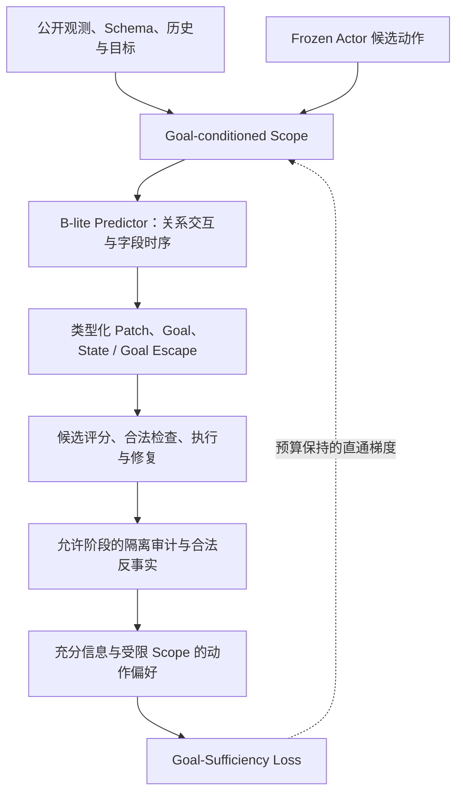

# RepairScope v2

**Goal-Sufficient Dynamic Scope Learning for Reliable Long-Horizon Agents**

当前执行阶段：**只推进Ours/A4，正式实验尚未启动**。一次离线续接已结束，先按 [当前结论与交付任务](docs/V2_POST_CONTINUATION_DECISION.md) 移交实际补丁和完整数据计划；[自主续接说明](docs/CLAUDE_OURS_ONLY_CONTINUATION.md)中的预算与执行约束继续有效。其他对照、消融和B暂不运行。修改需及时记入 [变更记录](docs/CHANGELOG.md) 和服务器Markdown日志。

在固定字段预算下，学习足以支持目标保护决策的动作作用范围。

RepairScope v2 面向长程工具 Agent：一次动作既可能推进当前任务，也可能破坏已经满足的业务目标。方法使用同一合法前缀上的真实反事实动作结果，让 Scope 选择器学习“哪些信息会改变目标保护决策”，并用同一个 Predictor 支持执行前选择、合法检查与执行后修复。

`main` 是新版方法的入口。普通 clone 即获得当前代码，无需切换功能分支。

| 文档 | 用途 |
| --- | --- |
| [当前结论与交付任务](docs/V2_POST_CONTINUATION_DECISION.md) | 已完成离线续接的证据边界、实际补丁和正式计划移交 |
| [Ours-only自主续接](docs/CLAUDE_OURS_ONLY_CONTINUATION.md) | 持续有效的Ours-only、预算、准入及修改记录约束；离线步骤已完成 |
| [完整 Proposal 与 Evaluation Plan](docs/RepairScope_v2_Proposal.md) | 动机、相关工作、数学定义、损失、信息边界、实验与指标 |
| [服务器 Claude 执行任务](docs/CLAUDE_GOAL_SUFFICIENT_EXPERIMENT.md) | 复用现有环境、同步代码、必要真实 Smoke、共享数据和正式实验 |
| [协作与执行约定](CLAUDE.md) | 仓库操作、实验与数据边界 |
| [代码来源记录](docs/UPSTREAM.json) | 复用代码的来源追溯 |

## 方法



- **Goal-Sufficiency。** 在同前缀、同条件的 action/reference 两候选组中，用充分离线效用作为教师。受限 Scope 内采用真实离线补丁、范围外保留前态，构造决策蒸馏代理；监督直接进入实际 Scope gate，不是只训练独立辅助头。
- **固定预算选择。** 硬前向采用 Top-k 和预算内覆盖预留，反向采用固定质量松弛的直通估计。它提供有偏训练信号，不证明离散最优性或最小真实因果范围。
- **共享预测器。** 保留动作条件关系块、字段级时序注意力、类型化 State Patch 和多步递推。Actor 参数冻结，预防与修复使用同一 Predictor。
- **互补监督。** Boundary 学条件化作用支持；State Escape 学一般遗漏变化；Goal-Relevant Escape 学有可靠证据的目标保护遗漏。一般字段变化不自动视为目标损害。
- **轻量探索。** 使用同模型 MC 假设的字段与候选决策分歧、目标风险及真实分支成本选择训练证据，保留随机探索。没有额外 Explorer 模型、RL、RSI 或 Memory Agent。

推理只使用公开当前状态、Schema、目标、当前动作和既有历史。未来结果与隐藏审计仅作允许阶段的离线标签；测试期不更新 Predictor、不执行反事实搜索，也不使用官方 checker 帮助动作选择。未知标签保留 unknown。

## 证据状态

本仓库提供方法实现、单元测试、合成工程 fixture 和实验协议。**这些不构成真实 AppWorld 方法效果、RTX 4090 性能或跨环境泛化证据。** 当前没有可据此宣称的任务提点结果。

真实训练首先需要正确绑定的公开业务目标、合法可比较反事实分支，以及固定预算下可学习的范围竞争。训练入口会拒绝没有可训练目标决策组的 Goal-Sufficiency 训练；完整数据预审计也不能替代实际 batch 中新增损失、Scope 梯度和参数更新的验收。

`smoke` 使用 CPU synthetic fixture，只检查工程链路。真实 AppWorld/GPU Smoke 与科学评估按服务器执行任务进行；通用 `complete` 或答案非空不代表业务目标已经验证。

## 安装或复用环境

```bash
git clone https://github.com/Hang-276/RepairScope.git
cd RepairScope
```

需要 Python 3.11 或更高版本，以及 PyTorch、NumPy、PyYAML。正式 AppWorld 实验使用 Linux；目标设备为单卡 RTX 4090，实际资源据运行记录报告。

### 已有服务器环境

优先复用现有 Python 环境、AppWorld 数据、冻结 Actor 服务、权重和缓存。将 `REPAIRSCOPE_PYTHON` 设为已有环境的 Python 绝对路径，并确保导入当前 checkout：

```bash
export REPAIRSCOPE_PYTHON=/absolute/path/to/existing/.venv/bin/python
export PYTHONPATH="$PWD${PYTHONPATH:+:$PYTHONPATH}"
"$REPAIRSCOPE_PYTHON" -c 'import repairscope; print(repairscope.__file__)'
"$REPAIRSCOPE_PYTHON" -m repairscope --help
```

输出模块路径应位于当前仓库。原环境正常时不重新安装、下载模型或覆盖数据。具体服务器路径和同步步骤见[服务器执行任务](docs/CLAUDE_GOAL_SUFFICIENT_EXPERIMENT.md)。

### 新建本地开发环境

```bash
python3.11 -m venv .venv
source .venv/bin/activate
python -m pip install -e '.[test]'
python -m repairscope --help
```

全新 Linux 实验服务器可使用 `bash scripts/repairscope/setup_server.sh` 安装项目和固定 AppWorld 依赖。该脚本创建仓库内 `.venv`；已有环境应走复用路径。AppWorld 数据、Actor 服务和公开观测/目标映射需单独配置，安装依赖不代表真实实验已就绪。

## 快速开始

### 本地工程检查

```bash
python -m pytest -q tests/repairscope
python -m repairscope smoke \
  --config configs/repairscope/goal_sufficient.yaml \
  --output-dir runs/v2-engineering-smoke
```

使用未占用的输出目录。合成 Smoke 不访问真实 AppWorld 或 Actor 服务，不用于筛选方法效果，也不替代实际 Goal-Sufficiency 梯度验收。

不执行环境或训练的配置预览：

```bash
python -m repairscope train \
  --config configs/repairscope/goal_sufficient.yaml --dry-run
```

### 真实实验所需输入

在服务器配置中绑定真实绝对路径，至少包含：

| 输入 | 配置或来源 |
| --- | --- |
| AppWorld 数据与版本 | `environment.root` 或 `APPWORLD_ROOT`；固定 release/commit 与官方清单 |
| Frozen Actor | `actor` 配置及已有服务；凭据通过安全环境变量提供 |
| 公开观测映射 | `environment.observation_map` |
| 公开业务目标与实体绑定 | `data.goal_map`；由公开指令、API 与合法返回支撑 |
| 共享训练数据 | 官方 train 自然轨迹和合法反事实 JSONL |
| 冻结 dev 数据 | dev 自然轨迹及显式 evaluation-only 候选组 |
| 反事实计划 | 完整合法 prefix、action/reference、条件操作及只读证明 |

配置文件的 `base` 必须指向当前仓库的配置，不复制旧源码来解决路径问题。fixture 中的订单示例只说明格式，不能用作真实 benchmark 数据。

### 正式入口

主 A 入口是 `scripts/repairscope/run_goal_sufficient_main.sh`：共享数据只采集一次，随后执行 Frozen Actor、预测/效果学习对照、完整 v2，以及去 Goal-Sufficiency、去 Boundary、去 Goal Escape 和静态范围对照。基线用于检验新版方法，不构成另一套默认主流程。

先将下列路径替换为已冻结的真实产物：

```bash
export REPAIRSCOPE_PYTHON=/absolute/path/to/existing/.venv/bin/python
export CONFIG=/absolute/path/to/server-v2.yaml
export TRAIN_DATA=/absolute/path/to/shared-train.jsonl
export EVAL_DATA=/absolute/path/to/frozen-dev.jsonl
export RUN_ROOT="$PWD/runs/repairscope_v2_seed100"

SEEDS=100 DRY_RUN=1 bash scripts/repairscope/run_goal_sufficient_main.sh
```

`RUN_ROOT` 必须是未占用的新目录，名称包含 `v2` 或 `goal_sufficient`。完成必要真实 Smoke、输入冻结和费用核算后，用同一配置去掉 `DRY_RUN=1` 执行。首轮固定 seed100、30 epochs、H4、Scope128、候选字段256；详细训练与控制预算以完整 Proposal 和服务器任务为准。

主 B 使用 `scripts/repairscope/run_goal_sufficient_b.sh`，从同一完整 v2 checkpoint 和同一 train-only 计划池比较四种采样策略。每策略 2000、合计 8000 只约束探索采集 ledger；冻结查询另外计费，须事先纳入已批准总预算。查询或全局上限未明确时不启动 B，不自动追加训练、Pilot 或调参。

## 命令与产物

所有入口支持 `python -m repairscope ...`；安装后也可使用 `repairscope ...`。

| 命令 | 用途 |
| --- | --- |
| `doctor` | 核对运行依赖与真实环境配置；不是 benchmark 验收 |
| `collect` | 收集 train/dev 自然轨迹及允许的离线审计 |
| `counterfactual` | 按冻结合法计划收集分支；默认 train |
| `train` | 拟合 Predictor，保存 checkpoint、配置与监督审计；支持同协议精确续训 |
| `predict-eval` | 固定记录上的 H1/H2/H4 预测、目标范围指标和两候选 Regret |
| `calibrate` | 每个 checkpoint 的一次 dev 阈值选择 |
| `evaluate` | 冻结在线系统与独立 AppWorld 原生评分 |
| `probe` | train-only 预算化采集及 Predictor 更新，查询结果不回流 |
| `validate-data` / `aggregate` | 数据来源/划分检查与运行结果汇总 |

dev 反事实必须显式开启评估模式，且计划中 `split`、`source_split` 都为 `dev`：

```bash
"$REPAIRSCOPE_PYTHON" -m repairscope counterfactual \
  --config "$CONFIG" --plans "$DEV_CF_PLANS" \
  --set collection.split=dev \
  --set collection.counterfactual_evaluation_only=true \
  --output-dir "$DEV_CF_OUTPUT"
```

该路径保存冻结计划哈希，输出 `frozen_query=true`、`used_for_training=false`；禁止 test/challenge 分支采集。dev 记录不进入训练集构建器、探索或 replay。

关键产物包括配置与来源 Manifest、`goal_supervision_audit.json`、`metrics.jsonl`、`checkpoint.pt`、预测 `predictions.jsonl`、校准收据、逐任务系统结果和费用记录。数据、模型权重、密钥、环境与运行目录不提交到源码仓库。

## 指标与实现边界

正式系统报告原生 TGC/SGC、可判定目标退化、修复恢复与新增损害、实际动作/检查/Actor/Predictor 成本。原生 checker 覆盖不足时官方指标为 N/A；修复的两项边际比例不等于完整修复事件成功率。

机制指标包括 Goal-Relevant Recall@B、State/Goal Escape，以及同合法 action/reference 组上的实际预测评分 Decision Regret。Regret 包含 Predictor 与部署评分的共同影响，不是 Scope 单独因果效应；oracle-patch Scope 诊断单独报告。未知不作负例，并列原始分子、分母、Mask 与覆盖率。

显式设置 `evaluation.scope_budgets` 可对同一 checkpoint、固定候选上限的 dev 记录计算离线字段预算曲线。它不产生新的环境执行，也不是完整系统的任务成功—检查成本前沿。Scope 当前没有完整压缩 dense 计算，字段预算不能直接换算为延迟或显存收益。

首轮单 seed 不能证明跨训练种子稳定性。AppWorld 是唯一首轮主环境；WorkArena、AndroidWorld、WindowsWorld、OSWorld、LegacyWorld、WebArena 等仅属于后续准入候选，仓库不宣称已完成其适配或跨环境结果。
