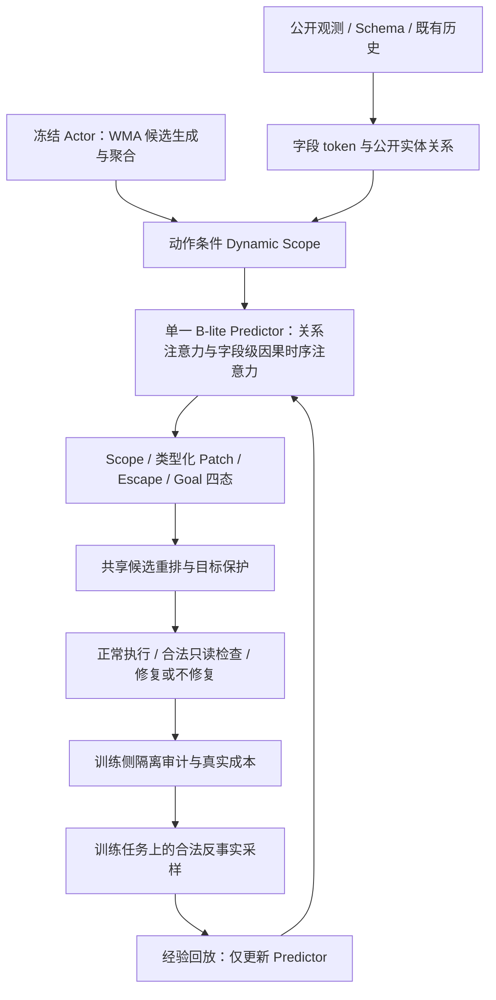

# RepairScope

**面向目标保护的动态作用范围学习：结合 JEPA 的预测思想与结构化时序 Transformer。**

本仓库在 [WMA 官方实现](https://github.com/kyle8581/WMA-Agents) 上实现 RepairScope，用于 AppWorld。我们学习动作会影响哪些字段、影响如何随条件变化，以及当前预测范围是否遗漏副作用；再用同一个预测器支持执行前的动作选择与执行后的修复。研究假设由主实验检验，目前不宣称已有真实任务提点。

**服务器 Claude 必须先阅读 [CLAUDE.md](CLAUDE.md) 和 [交接提示词](docs/CLAUDE_SERVER_HANDOFF.md)。Idea 与机制被冻结：机制相关 bug 必须停止受影响实验并等待用户审批；不改变方法语义的工程 bug 可自行修复，修复日志必须放在仓库外。**

## 文档入口

| 文档 | 内容 |
| --- | --- |
| [研究 proposal](docs/REPAIRSCOPE_PROPOSAL.md) | 完整问题、架构、损失、实验计划与文献定位 |
| [方法与实现](docs/REPAIRSCOPE.md) | 实际复用 WMA 的范围、默认配置、消融脚本索引 |
| [实现对应表](docs/IMPLEMENTATION_COVERAGE.md) | 设计到代码的对应关系及实现边界 |
| [服务器运行指南](docs/SERVER_RUNBOOK.md) | 安装、真实数据配置、采集、训练与主实验命令 |
| [服务器 Claude 交接](docs/CLAUDE_SERVER_HANDOFF.md) | 可直接复制的任务提示词与审批规则 |
| [本地验证](docs/LOCAL_VERIFICATION.md) | CPU synthetic 工程证据与尚未验证的真实环境部分 |

## 核心 idea

普通动作效果预测回答“执行后变成什么”，RepairScope 还要回答“当前条件下影响会传播到哪里，哪些已满足目标可能受损，已有预测范围何时不可信”。例如，修改订单配送方式可能在普通条件下仅改变配送字段，却在某个合法业务条件下额外改变付款状态。我们希望在固定预测与执行预算内学会这种条件化作用边界，并在不确定时选择合法检查或更安全的候选。

候选贡献是**预算约束下的条件化作用边界学习与修正闭环**。JEPA、Transformer、反事实与在线更新是方法基础；它们本身不是新颖性或有效性保证。

## 架构与数据流



1. **状态表示。** 按应用、实体、字段组织 token，保留类型、已知性、更新时间、公开关系与历史。数值归一化，类别/布尔使用离散表示，ID 与文本优先使用引用/复制槽；不能合法观察的值保持 unknown。
2. **Dynamic Scope。** 从动作参数、公开关系与合法检索构造候选，结合学习作用分数、目标重要性、不确定性和越界风险，在固定预算内选择预测范围。静态关系是先验，允许跨静态关系与少量随机覆盖。
3. **单一 B-lite。** 当前动作参与字段关系交互，再通过字段级因果时序注意力读取既有历史。预防与修复共享同一组 Predictor 参数。首轮固定维度384、6头、关系块4层、时序块2层、历史8步、候选256、Scope128、rollout H=4。
4. **预测输出。** 类型化 Patch 包含保持/修改/新增/删除及字段值、引用或复制分布；Scope 头预测作用范围，Escape 头预测声明审计域内的遗漏风险，Goal 辅助头保留 00/01/10/11 四种目标转移。
5. **决策。** 冻结 Actor 产生4个候选，以预计进展、受保护目标损害、风险和成本重排。必要时合法只读检查；执行后修复候选包含继续执行/不修复，识别多余修复。

## 训练与条件化边界

基础训练由单步 Scope/Patch/Goal 监督与自由递推监督组成。Rollout 从真实起点出发，之后仅输入模型预测状态与历史，报告 H=1/2/4 硬递推结果。

同一可比前缀下，合法执行参考动作与目标动作；需要研究条件依赖时，在两个可执行条件下组成四格。Boundary 比较两个条件下的“目标动作相对参考动作的作用支持变化”，不把条件本身的状态变化当成动作效果。Escape 标签检查实际变化是否落在执行前保存的范围外；部分审计且没有正例时不能填0。

$$
\mathcal L = \mathcal L_{scope}+\mathcal L_{patch}+\mathcal L_{goal}
+\lambda_1\mathcal L_{roll}+\lambda_2\mathcal L_{boundary}+\lambda_3\mathcal L_{escape}.
$$

首轮各权重为1，AdamW、学习率 `3e-4`、weight decay `0.01`、micro-batch4、累积4、BF16、梯度裁剪1.0、30 epochs；前10%更新仅 Step+Rollout 预热，不另设有效性筛选阶段。JEPA 在这里体现为预测式学习思想；首版直接监督结构化状态，**不另设 EMA target encoder**。

软分布/数值/复制引用用于可微递推。硬检索、Top-k、JSON 解码与无绑定新实体或字符串不宣称可微；梯度边界写入模型 manifest。

## 风险引导探索

在训练任务的同一合法候选实验池中，按下式选择真实执行证据，并保留 `epsilon=0.1` 的随机覆盖：

$$
V(q)=\frac{U(q)D(q)R(q)}{C(q)}.
$$

U 是范围不确定性与 Escape 风险，D 是共享模型 MC 假设对候选实验结果的分歧，R 是预计受保护目标损害，C 是完整分支与续跑成本。它是预算调度启发式，不是信息增益保证。记录选择概率、失败调用、完整前缀、条件、合法检索与真实成本；周期回放只更新 Predictor。冻结查询任务的结果不回流训练。

## 主实验：一次必要 smoke 后直接运行

不做反复 pilot、额外可行性 gate、超参网格搜索，或因小样本无提点而修改 idea。

| 实验 | 固定比较 | 入口 |
| --- | --- | --- |
| 主 A，相同数据 | A0 冻结 Actor；A1 dynamics；A2 成对 effect/support；A3 完整方法；A4 去 Boundary；A5 去 Escape | `scripts/repairscope/run_main_a.sh` |
| 主 B，相同真实执行预算 | 相同 A3 起点、损失与候选池：随机、不确定性、新颖性/可学习性、风险引导 | `scripts/repairscope/run_main_b.sh` |
| 模型/损失消融 | 静态 Scope、去学习边、去时序、统一 Transformer、去 rollout、去 Goal | `scripts/repairscope/run_all_ablations.sh` |
| 不增加探索 | 相同起点、零探索预算与冻结查询 | `scripts/repairscope/ablate_no_probing.sh` |

默认种子 `100 101 102`。各独立 `.sh` 见[完整索引](docs/REPAIRSCOPE.md)。主 A 固定数据、Actor、候选数、选择器与预算；主 B 固定起点、候选池、损失与总执行预算。测试期不更新、不进行反事实分支搜索。dev 仅用于主预测指标和一次阈值选择，阈值绑定起点 checkpoint 并冻结。

报告原生 TGC/SGC、受保护目标损害、修复恢复与新增损害、Scope 预算覆盖、Escape 校准、类型化误差、H=1/2/4 递推、分组置信区间及成本。无提点也如实报告主对照和消融，不自动追加验证轮次。

## 开始运行

```bash
git clone https://github.com/Hang-276/RepairScope.git
cd RepairScope
# 先阅读 CLAUDE.md 和 docs/SERVER_RUNBOOK.md
bash scripts/repairscope/setup_server.sh
```

安装脚本面向 Linux/Python 3.11。需要配置 AppWorld 数据、冻结 Actor 服务、公开观测/目标映射和合法训练分支计划。它们是真实环境的数据对齐输入，仓库的 fixture 只是格式示例，不能直接作为正式数据。完整准备与主实验命令见[服务器指南](docs/SERVER_RUNBOOK.md)。

## 机制冻结与 bug 处理

- **禁止自行修改方法机制。** 包括架构、损失及标签语义、Scope/Boundary/Escape、采样公式、目标保护/修复决策语义、数据隔离、指标定义、对照和预算公平性。发现实现与 proposal 不一致也不能自行“修正机制”；应停止受影响实验，提交证据、拟议修复和影响，等待用户明确审批。不确定时按机制问题处理。
- **工程 bug 可自主修复。** 如路径、环境安装、序列化、日志、接口兼容，以及能够证明不改变方法语义的设备/运行错误。修复后只做必要的最小回归，再接续原实验。需要改变 BF16、有效 batch、训练计划或预算等固定条件时先审批。
- **修复日志必须在仓库外。** 默认使用仓库父目录下 `RepairScope-server-notes/BUGFIX_LOG.md`，启动时确认解析后的路径不位于工作树内。每次记录 UTC 时间、commit、症状、根因、为何不改变机制、diff/hash、验证和已耗预算；不得将日志或凭据加入仓库。机制阻塞同样在该日志记录并等待审批。

## 复用 WMA 与验证边界

这份代码直接基于 WMA commit `dd894640204895b52f050c66cc0b58f08e00f9b8`。候选生成、频数聚合、Top-k、概率归一化和稳定重排抽到 `agent/wma_core.py`，原 `agent/world_model_agent.py` 与 RepairScope 均调用；桥接器保留 WMA 原策略/提示词接口。新方法没有从零重写这条工作流。网页 HTML 状态预测和 WebArena Docker 从默认链路移除，原文件保留作上游参照。

上游说明保存在 [WMA README](docs/upstream/WMA_README.md)，原始图片链接应在[上游页面](https://github.com/kyle8581/WMA-Agents/tree/dd894640204895b52f050c66cc0b58f08e00f9b8)查看；版本来源见 [UPSTREAM.json](docs/UPSTREAM.json)。WMA 论文：Chae et al., *Web Agents with World Models*, ICLR 2025。

本地 **84 项工程测试通过**；仅 Mac CPU synthetic，已跑通5次优化更新、checkpoint、H4递推、控制器、合法四格和回放闭环。真实 AppWorld、CUDA/BF16、显存和实际提点尚未测量。合成结果不作为科学效果证据。
