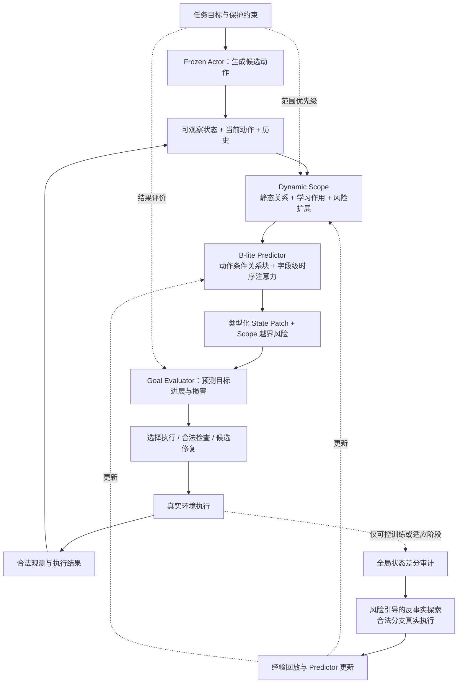

# RepairScope：面向目标保护的动态作用范围学习

*结合 JEPA 预测思想与结构化时序 Transformer 的研究 proposal*

> 当前执行安排（2026-10-18）：先只做一组最核心主对照，A1 普通预测器 vs A3 完整 RepairScope，固定种子100，共享数据、评测集、训练计划与预算。完成后汇总并停止等待用户决定。下文保留完整研究计划，但 A0/A2/A4/A5、其它种子、主 B 和所有消融本阶段均不启动；方法架构与机制保持不变。

版本 1.1  |  2026年10月18日

### 摘要

长程交互式 Agent 的一次正常操作，可能在推进当前目标的同时破坏此前已满足的要求。普通状态预测能够描述变化，却未必可靠覆盖低频、条件依赖的副作用。RepairScope 研究：能否从真实执行与反事实对照中，持续修正动作的影响范围，并将这种知识迁移到新的条件和动作组合，以有限的预测、检查与修复预算保护任务进度。

方法采用冻结 Actor 与单一 B-lite Predictor。预测器以可观察的结构化状态、当前动作和历史为输入，结合动作条件关系块、字段级时序注意力与共享参数的多步递推，预测稀疏 State Patch。Dynamic Scope 根据静态关系、学习得到的作用关系和风险扩展候选范围；反事实边界监督与范围越界监督共同修正这一范围；风险引导的反事实探索负责选择值得补充的真实执行证据。

## 1  研究问题与核心假设

**核心问题：**在新的目标组合、环境条件与动作序列中，Agent 能否识别此前遗漏的副作用，并在相同资源预算下减少目标退化？

| 假设 | 需要观测到的证据 |
| --- | --- |
| H1：范围可修正 | 固定 Scope 预算下，真实副作用覆盖率提高，范围外漏检减少。 |
| H2：关系可组合 | 在未见条件及动作组合上，硬 State Patch 递推和目标影响判断优于普通预测器。 |
| H3：探索有决策价值 | 相同反事实执行预算下，比随机或一般不确定性采样更快降低目标损害。 |

拟争取的贡献是**预算约束下的条件化作用边界学习与修正闭环**。JEPA、Transformer、成对反事实和持续更新各自已有直接先例；它们是方法基础，贡献成立与否由等预算主实验决定。

**执行路线：**锁定架构、数据划分、主对照和预算，只做一次必要的链路 smoke test，随后直接进行主实验。通过同一批主结果判断提点与机制贡献，不设置逐阶段的小规模有效性试验。

## 2  任务定义与总体架构

设环境真实状态为 xₜ，Agent 的合法观测为 oₜ；由观测、公开 API schema 和历史构造可见状态 sₜ。sₜ 只表达已知信息，未知字段保留 unknown。动作 aₜ 可以是普通任务操作，也可以是候选修复。历史 hₜ 包含已发生的动作与状态信息。

目标集合 G 分为最终完成条件与必须持续保持的约束。对于普通子目标，明确从何时起需要保护；不把任务过程中允许发生的暂时变化一律判作破坏。每个目标使用可验证的谓词或检查器，不将 LLM 的判断直接视为真实标签。

$$
F_\theta(s_t,a_t,h_t)\rightarrow(\widehat{\Delta s}_{t+1},p_t,r_t)
$$

其中 Δŝ 为类型化状态补丁，p 为字段变化概率，r 为当前 Scope 遗漏影响的风险。Goal Evaluator 将预测状态转成逐目标的保持、恢复或损害判断。更换目标可以改变检查优先级和效用评价；在相同状态与动作下，客观状态转移预测应保持一致。

*图1：共享预测器支持预防与修复；全局审计及反事实分支仅用于可控训练或适应阶段。目标参与范围优先级与结果评价，客观动力学由状态、动作和历史决定。*

### 一个贯穿示例

任务要求修改订单配送方式并保持已支付状态。在条件 c₀ 下，修改仅改变配送信息；在合法条件 c₁ 下，同一操作还会改变支付状态。模型应学习“何时支付状态需要进入检查范围”，并比较保留支付状态的替代操作。该例用于说明机制，具体实验必须由 AppWorld 中真实可执行、可核验的场景承载。

## 3  B-lite 与 Dynamic Scope

### 3.1  结构化字段表示

状态按“应用—实体—字段”组织 token，包含实体类型、字段类型、值表示、已知性、最近更新时间和公开关系。类别与布尔量用离散嵌入，数值归一化，自由文本可使用冻结编码器；对象 ID 作为引用或复制目标处理，不进行数值回归。新实体先用类型化占位槽表达，真实 ID 在合法执行返回后绑定。

### 3.2  作用范围的生成与扩展

先由动作参数、公开关系和合法检索建立候选集合 Cₜ；轻量字段打分器选择初始范围 Mₜ⁰。学习得到的作用关系用于排序，重要目标、预测不确定性与越界风险用于扩展，形成实际预测范围 Mₜ。静态关系作为先验与 attention bias，不构成封闭的硬边界。

| 组成 | 职责 |
| --- | --- |
| 静态关系 | 利用 API 类型、已知实体关系及字段依赖组织候选。 |
| 学习作用关系 | 判断当前动作与条件下，哪些候选字段可能受影响。 |
| 可靠性与风险扩展 | 在预算内扩大候选、读取相关对象，或转入保守检查。 |

必须保留未知关联的入口：从公开 search/list/read 接口发现实体，允许跨静态关系的候选边，并保留少量随机覆盖。检索和扩展均计入成本。对完全不可观察、无法合法枚举的影响，只能估计风险，不能声称完整覆盖。

### 3.3  动作条件关系块与时序注意力

**关系块：**将当前动作嵌入并入字段查询，以公开关系和学习作用分数作为 attention bias，在当前 Scope 内进行4层关系交互，输出每个字段的动作条件特征。使用软关系权重，保留跨静态边的信息通道。

**时序块：**当前字段特征作为 query，最近8步的字段/动作历史作为 key、value，经过2层因果 Temporal Attention。保留字段级信息，不压缩成单个全局历史向量；第 k 步不读取未来动作或真实未来状态。其输出同时送入 Patch、Scope 与 Reliability 预测头。

输出包括新增、删除、修改、保持的操作类型，字段值或引用分布，以及变化概率 pⱼ。Scope Reliability 复用共享表示，预测 r(s,a,M)：**已记录范围 M 是否会遗漏可审计的真实变化**。目标信息用于范围调度与评价，不能任意改写基础 dynamics。

### 3.4  多步递推

$$
\hat{s}_{t+k+1}=\operatorname{Apply}\!\left(\hat{s}_{t+k},F_\theta(\hat{s}_{t+k},a_{t+k},\hat{h}_{t+k})\right)
$$

每步共享参数，仅用起点合法观测与预测槽重选 Scope，不查询未来真实环境。首轮固定 d=384、6个注意力头、4层关系块+2层时序块、历史8步、Scope 上限128个字段 token、候选上限256、H=4。字段索引跨步对齐，缺失项为 unknown；报告 H=1、2、4 的硬递推结果。

## 4  数据构建与基础训练

### 4.1  自然轨迹与真实反事实

自然轨迹来自冻结 Actor 在 AppWorld 训练任务中的真实执行。记录动作前合法观测、API 名称与参数、执行结果、状态变化、目标影响、历史、模型版本和执行成本。同一轨迹滑动生成单步及 H∈{2,4} 的连续窗口。

反事实从相同前缀的隔离 checkpoint 分支出发，分别执行动作 a 与合法参考动作 aᵣ。只有接口允许且时间、随机性可比时，跳过或 no-op 才能作为参考；否则使用有效替代操作。条件对照必须通过环境中合法操作构造，不能仅替换输入 token。所有分支结果由真实执行取得。

离线全局差分可提供训练监督和评估真值，但与在线输入严格隔离。全局数据库、隐藏任务检查器、未来返回值和真实目标满足标记不进入 Predictor。部分审计时，无法确认的字段为 unknown，不作为“不变”负样本。

### 4.2  单步损失

$$
\mathcal{L}_{\mathrm{step}}=\mathcal{L}_{\mathrm{scope}}+\alpha\mathcal{L}_{\mathrm{patch}}+\beta\mathcal{L}_{\mathrm{goal}}
$$

Scope 使用带有效性掩码的字段级加权 BCE，控制对副作用漏检的惩罚。Patch 按类型监督：操作与类别用分类，数值用稳健回归，ID 和文本优先复制或引用。损失同时覆盖已审计的变更与不变字段，防止只学习高频改动。Goal 使用经核验的训练侧标签，未知目标不参与监督。

逐目标标签保留 00、01、10、11 四种转移，分别表示未满足、恢复、退化、保持。对必须持续满足的条件单独统计损害；辅助目标头用于可微训练，实际部署尽量由明确谓词评价预测状态，并对不确定值保留 unknown。

### 4.3  自由递推监督与梯度边界

$$
\mathcal{L}_{\mathrm{roll}}=\frac{1}{H}\sum_{k=1}^{H}\ell(\hat{s}_{t+k},s_{t+k})
$$

Step 从真实当前状态学习局部转移；Roll 从真实起点出发，持续使用模型预测状态并监督每一步。训练时对类别使用软分布、数值使用连续估计、复制槽使用软引用，以支持跨步反向传播。

离散 JSON 应用、硬检索、硬 Top-k、未知实体拓扑变化不自动可微。首版在固定候选字段和预留实体槽内递推，明确标注梯度截断位置；新增自由文本等未覆盖分支仍接受逐步监督。正式指标使用硬 Patch 递推，同时报告软训练与硬执行的差距。

模型借鉴 JEPA 的预测式学习思想，但首版直接监督结构化状态，不另设 EMA target encoder。训练固定为一次运行：前10%的优化步仅用 Step + Rollout 预热，其后加入已确定的反事实目标；不另做一轮有效性验证，也不以小样本提点决定是否继续。

## 5  反事实与动态范围的联合学习

研究重心是条件变化如何改变影响边界，以及模型何时应怀疑已有范围不完整。反事实对照与范围选择共同形成反馈，不只增加额外状态样本。

### 5.1  条件化边界监督

| 合法条件 | 参考动作 aᵣ | 目标动作 a |
| --- | --- | --- |
| c₀ | x′₀,ᵣ | x′₀,ₐ |
| c₁ | x′₁,ᵣ | x′₁,ₐ |

对每个字段 j，yⱼᶜ 表示同一条件下两个执行后结果是否存在语义差异。它比较 a 与 aᵣ 的结果，排除条件本身带来的初始状态差异。qⱼᶜ 是由两个预测结果经过类型化、可微差分得到的 [0,1] 作用支持分数；它不是单个条件下的任务成功概率。

$$
\mathcal{L}_{\mathrm{boundary}}=\sum_j m_j\left[(q_j^{c_1}-q_j^{c_0})-(y_j^{c_1}-y_j^{c_0})\right]^2
$$

类别字段可比较预测分布的差异，数值字段按预先固定的语义阈值转成软变化分数，字符串和 ID 使用相等性或引用差异。mⱼ 要求四分支字段可对齐、已审计且动作有效。每个分支仍接受基础 Step 监督；缺失或无效分支不填零。该目标学习条件引起的作用支持变化，具体取值仍由 Patch 监督约束。

### 5.2  越界风险监督

执行前保存实际使用的 Mₜ、动作和模型版本；执行后获得实际变化集合 Aₜ。统一过滤规则处理时间戳、日志等背景变化。定义：

$$
e_t=\mathbf{1}\!\left[A_t\setminus M_t\neq\varnothing\right],\qquad\mathcal{L}_{\mathrm{escape}}=\operatorname{BCE}(r_\theta(s,a,M),e_t)
$$

发现范围外变化时标签为1；只有已完整审计所声明字段域，才能将“未发现遗漏”标为0。部分审计且无正例时，该样本不参与 escape 负类监督。每个风险概率均对应明确的审计字段域，不能解释成对不可观察世界的完整保证。

历史 escape 标签对应历史 Scope；若用新模型重选 Scope，必须由保存的完整差分重新标注。使用模型外生成的范围子集和随机审计样本扩大覆盖，防止只学习自身选择偏差。硬范围选择不依赖 escape BCE 获得直接梯度，字段级 Scope 与边界监督负责学习扩展到哪里。

### 5.3  总目标与预算

$$
\mathcal{L}=\mathcal{L}_{\mathrm{step}}+\lambda_1\mathcal{L}_{\mathrm{roll}}+\lambda_2\mathcal{L}_{\mathrm{boundary}}+\lambda_3\mathcal{L}_{\mathrm{escape}}
$$

在固定 Scope 预算 B 下比较覆盖与漏检，同时报告范围大小、检索次数及延迟，避免全量范围消除 escape。多步中仅对具有有效四格的步骤施加 Boundary，对具有有效审计标签的步骤施加 Escape，其余掩码；不假设自然窗口自动拥有逐步四格标签。

## 6  目标保护、反事实探索与持续更新

### 6.1  预防与修复共享一个预测器

Frozen Actor 生成固定数量的候选动作；Predictor 估计结果、目标影响与遗漏风险。Goal Evaluator 仅使用公开任务要求、合法谓词或学习头，隐藏官方 checker 仅用于离线标签与评估。决策器按预计进展、目标损害和成本排序；风险超阈值时进行合法只读检查或生成替代动作，阈值在 dev 一次性确定。

真实执行后，根据合法观测验证结果。若出现受损目标或预测偏差，再由同一 Actor 产生局部修复、较大范围重规划等候选，交给同一 Predictor 排序。候选必须包含继续执行或不修复的选项，以识别多余修复。收益相近时优先选择成本和预计影响范围较小的方案；只主张候选集合内的选择质量。

### 6.2  风险引导的反事实探索

探索在可控训练环境中进行。先发现潜在遗漏，再从规则生成的合法动作或条件变化中，选择最能区分竞争解释的实验。首版不增加独立 RL Explorer 或实验规划模型。

$$
V(q)=\frac{U(q)\,D(q)\,R(q)}{C(q)}
$$

| 量 | 首版定义 |
| --- | --- |
| U：范围不确定性 | 共享 Predictor 多次 dropout 前向的分歧，结合已校准的 escape 风险。 |
| D：实验区分力 | 同一候选实验下，不同预测假设对字段变化结果的分歧。 |
| R：目标损害 | 遗漏关联预计损害受保护目标的权重，按验证集尺度归一化。 |
| C：执行成本 | 完整分支及续跑所需调用、检索和运行时间的预估成本。 |

该乘积是预算调度启发式，U 与 D 可能相关，并非信息增益保证。所有分数归一化并给 C 设置正下限；保留 ε 比例随机实验，避免零分区域永远不被探索。简单动作对照足以解决的问题只用两分支；需要识别条件依赖时才使用四格。每次记录选择概率、实际成本与发现结果。

### 6.3  有边界的持续学习闭环

预测并记录范围 → 合法执行 → 离线全局差分审计 → 选择反事实实验 → 更新作用边界与风险 → 经验回放。只定期更新 Predictor，Actor 参数保持冻结；回放混合旧条件、新条件及范围外正例，监测旧能力遗忘。

主实验冻结模型后测试，不进行测试期 checkpoint 分支探索。持续适应实验另设数据流，遵循“先预测落日志、执行后获取允许的标签、随后更新”；适应数据与查询评估分离，不使用隐藏测试检查器训练。这里的自我改进指证据驱动的 Predictor 更新，不扩大为完整递归自我改进系统。

## 7  直接开展的主实验

主实验使用 AppWorld。WMA 提供直接 workflow 基线；Do-JEPA 与 OnlineWM 提供效果学习和主动采样对照 [1–4]。首轮只保留能回答核心问题的对照，统一使用 B-lite backbone 和同等目标评价能力；适配版本明确标记为 WMA-style、Do-JEPA-style，而非原文完整复现。

### 7.1  主实验 A：相同数据，比较最终提点

| 配置 | 训练与作用 | 运行 |
| --- | --- | --- |
| A0：Frozen Actor | 不接 Predictor，作为任务表现参照。 | 一次固定采集 |
| A1：普通预测器 | Step + Rollout；反事实分支全部作为普通 transitions。 | 3个种子 |
| A2：成对效果对照 | A1 + Do-JEPA-style effect/support 监督。 | 3个种子 |
| A3：RepairScope | Step + Rollout + Boundary + Escape；动态范围与风险检查。 | 3个种子 |
| A4：去掉 Boundary | 其余与 A3 相同，检验条件化边界监督。 | 3个种子 |
| A5：去掉 Escape | 保留普通不确定性扩展，去掉越界风险监督与对应调度。 | 3个种子 |

A1–A5 共用同一批自然轨迹、合法反事实分支和字段真值，训练步数与容量保持一致。固定反事实数据只生成一次、由全部方法共享，排除“完整方法见过更多环境结果”的解释。主要结果直接在完整预定评测集上比较，不先做小规模提点筛选。

### 7.2  主实验 B：相同执行预算，比较探索效率

采用相同起始 checkpoint 和总分支执行预算，直接比较随机、一般不确定性、新颖性/可学习性，以及风险引导探索，均运行3个种子。数据可以不同，但四格分支、失败调用、合法检索和续跑均计费。一次持续采集运行在预定的累计预算处记录学习曲线，不拆成多轮人工验证试验。

B 的各策略使用同一损失配置和同一候选实验池，因此差异来自采样。以每单位成本的遗漏发现率及冻结查询任务中的目标损害衡量收益；查询任务的真实结果不回流训练。OnlineWM-style 为适配采样对照，不声称复现其原始仿真环境结果。

### 7.3  统一评测条件

固定 Actor、提示、候选数与修复池、合法观测、选择器、检查及修复总预算。官方划分为主，所有源任务轨迹、窗口、条件变体和反事实兄弟分支同组；预先标记未见动作组合及未见条件/目标组合，在同一次主评测中分组报告。

统一 Transformer A、无时序块、跨应用迁移属于扩展实验，不作为首轮主实验的前置条件。

## 8  评价、实施顺序与判断标准

| 评价层 | 主要指标与口径 |
| --- | --- |
| 任务结果 | AppWorld 官方 TGC/SGC 按原生协议报告；补充目标退化率、修复恢复率与修复新引入的损害。 |
| 作用范围 | Recall@B：固定预算覆盖真实变化的比例；Escape Rate：存在范围外真实变化的执行比例；同时报告 Scope 大小和误报成本。 |
| 预测与校准 | 类型化 Patch 指标、H=1/2/4 硬递推误差、目标四态 Macro-F1；escape 的 Brier score、可靠性图及风险—覆盖曲线。 |
| 探索与持续学习 | 每单位真实执行成本新发现的条件化关联、发现后的独立复验成功率、旧条件保持率和目标损害学习曲线。 |
| 资源与稳定性 | 调用数、查询数、延迟、训练时间和峰值显存；任务族 bootstrap 区间，训练随机种子至少3个。 |

目标退化按保护条件的有效时段统计，并与任务成功率同时报告，避免“少做动作”降低风险的假收益。Scope 覆盖指标明确分母是可审计变化域；零变化样本单独报告，不用其稀释漏检率。修复指标分别给出修复前受损目标与原本受保护目标的结果。

### 8.1  一次最小 smoke test，然后直接主实验

Smoke 仅使用1–2个训练任务：跑通一个动作对照、一个合法四格、2–5个优化步、一次 H=4 硬递推及一次执行—检查—修复调用。只检查数据字段、前向/反向、损失有限、参数更新、显存和日志。它不比较方法效果、不估计提点，也不作为算法筛选。仅当发现具体工程错误时修复失败链路。

Smoke 通过后，直接完成官方训练任务的固定轨迹采集、主实验 A 的共享数据训练与完整评测，并按预定预算运行主实验 B；不再插入独立 pilot、阶段性可行性检查或多轮小样本对照。

### 8.2  首轮固定配置与结果判断

采用第3节架构；AdamW，学习率 3×10⁻⁴，weight decay 0.01，micro-batch=4、累积4步，BF16、梯度裁剪1.0，30个 epoch。各损失按有效样本/字段归一化，α、β、λ₁、λ₂、λ₃ 均先设1；探索随机比例 ε=0.1。Scope=128、rollout=4、候选动作数=4，首轮不做网格搜索。

只有显存或数值错误触发必要工程调整；优先减 micro-batch 并增加累积以保持有效 batch，禁止只为完整方法增加预算。风险阈值在 dev 上一次性校准后冻结，主测试不参与参数选择。单卡4090为目标配置，Actor 采集与 Predictor 训练分时运行；训练时长和峰值显存由实际主实验报告。

主判定是同预算下的**任务完成—目标损害权衡**，同时列出相对 A1/A2 的绝对提升、置信区间和成本。如果主结果没有稳定提点，直接据对照和消融判断是否保留该机制，不以追加一串小验证试验替代主结论。

## 9  研究定位与参考文献

WMA 已建立冻结策略、世界模型预测与候选重排流程；Do-JEPA 已研究真实干预、作用支持与传播；OnlineWM 已研究主动反事实在线学习。RepairScope 的候选增量是：将条件化范围修正、遗漏风险和目标保护共同置于预算约束下，并检验对未见动作组合的实际决策价值。该定位是一项待验证假设，不构成“首次”的优先权声明。

I-JEPA 提供预测式表示学习的思想来源，Transformer 提供关系与时序交互的结构基础；二者均不自动保证动作因果归因、范围可信性或组合泛化。AppWorld 结果支持可控应用环境内的结论，向真实开放环境的迁移需要后续独立验证。

### 参考文献

[1] Chae et al. ICLR 2025. [Web Agents with World Models: Learning and Leveraging Environment Dynamics in Web Navigation](https://proceedings.iclr.cc/paper_files/paper/2025/hash/a00548031e4647b13042c97c922fadf1-Abstract-Conference.html)

方法对照：环境状态变化预测、冻结 Actor 与候选动作重排。

[2] Resani & Shi. arXiv:2609.37378, 2026. [Do-JEPA: From Masking to Intervention in Latent World Models](https://arxiv.org/abs/2609.37378)

最直接的训练机制邻居：action/reference 分支、effect/support 与传播、不变性监督。

[3] Miao et al. arXiv:2609.23753, 2026. [OnlineWM: Causality-Aware Active Online Learning for Effective World Modeling](https://arxiv.org/abs/2609.23753)

探索机制邻居：根据世界模型弱点主动采样并利用反事实分支改进模型。

[4] Trivedi et al. ACL 2024. [AppWorld: A Controllable World of Apps and People for Benchmarking Interactive Coding Agents](https://aclanthology.org/2024.acl-long.850/)

实验载体：多应用交互、程序化状态评测及附带修改检查。

[5] Assran et al. CVPR 2023. [Self-Supervised Learning From Images With a Joint-Embedding Predictive Architecture](https://openaccess.thecvf.com/content/CVPR2023/html/Assran_Self-Supervised_Learning_From_Images_With_a_Joint-Embedding_Predictive_Architecture_CVPR_2023_paper.html)

[6] Vaswani et al. NeurIPS 2017. [Attention Is All You Need](https://arxiv.org/abs/1706.03762)

### 预期成果

形成可复现的数据与范围审计协议、一个共享的结构化动作效果预测器，以及两组关键证据：固定数据下的边界学习增益，固定执行预算下的探索与目标保护增益。若核心假设不成立，也应明确普通预测器何时已足够，以及动态范围机制在哪些条件下失效。
