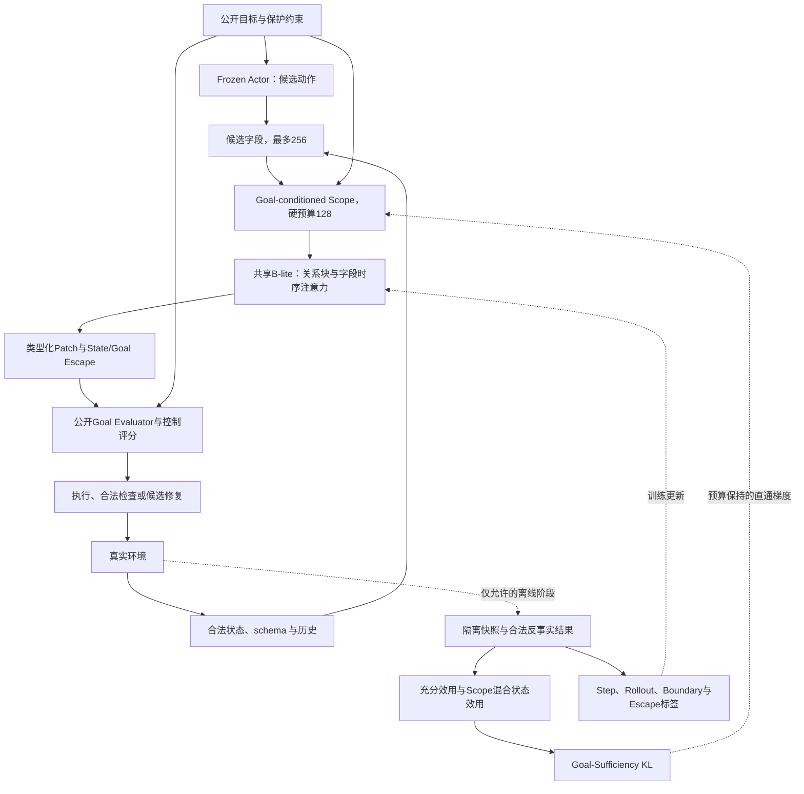

# RepairScope v2：Goal-Sufficient Dynamic Scope Learning for Reliable Long-Horizon Agents

**中文题目：面向长程 Agent 目标保护的决策充分动态作用范围学习**

版本：2.0 完整研究方案，2026-10-18。

> 当前Stage1已达到NO_IDENTIFIED_SCOPE_LEARNING_GAP停止条件，正式Ours未启动，见 [终局记录](STAGE1_RESULT.md) 和 [监督对象核对](GS_OBJECTIVE_REVIEW.md)。本文完整A/B/消融与跨环境计划保留为研究设计，不能据此继续采集或自动启动。实际修改需记录到Markdown变更日志。

代码依据：默认分支 `main`（新版交付分支 `feat/goal-sufficient-scope` 同步），核心提交 `62fd96e54891b799cf0819ae5e0c74253363f040`。本文整合研究动机、相关工作、形式化定义、架构、训练与完整 Evaluation Plan。旧版独立流程已从当前树移除，[v1.1 Proposal](https://github.com/Hang-276/RepairScope/blob/30e17abc4f59f4b0b4f2e84ada5c8987112b833e/docs/REPAIRSCOPE_PROPOSAL.md) 仅在 Git 历史中追溯；服务器路径与启动操作见 [Claude 实验交接](CLAUDE_GOAL_SUFFICIENT_EXPERIMENT.md)。

**证据状态：本文是待检验研究方案。代码、合成测试和静态检查不构成真实 AppWorld 方法效果、RTX 4090 性能、组合泛化或跨环境迁移证据。文中明确区分研究定义、当前实现和后续计划，不将尚未完成的评估写成结果。**

阅读索引：[研究动机](#1-研究动机) · [相关工作](#2-相关工作与创新边界) · [问题与假设](#3-研究问题假设与判定) · [形式化定义](#4-任务形式与-goal-sufficient-scope) · [架构](#5-总体架构与数据流) · [学习目标](#6-学习目标与梯度路径) · [数据](#7-数据构建与监督有效性) · [控制闭环](#8-预防检查与修复共享预测器) · [探索](#9-预算化探索与predictor更新) · [训练协议](#10-固定训练协议与一次工程验收) · [Evaluation Plan](#11-evaluation-plan) · [跨环境](#12-跨环境evaluation-pool) · [实施交付](#13-实施顺序与可复现交付) · [贡献与局限](#14-贡献局限与停止标准)。

## 摘要

长程交互式 Agent 的一次正常操作，可能推进当前要求，也可能破坏此前已经满足且仍需保持的目标。预测更多状态变化并不必然带来更可靠的决策：高频变化可能与目标无关，低频变化却可能使重要目标失效。在有限预测和检查资源下，关键问题是选择哪些状态信息，才能保留可靠的动作选择与目标保护能力。

RepairScope v2 研究 Goal-Sufficient Dynamic Scope Learning。方法保留 Frozen Actor、结构化字段表示、B-lite Predictor、动作条件关系块、字段级时序注意力、类型化 State Patch、共享参数多步递推、合法反事实采集与 Goal Evaluator。新增目标是：利用相同合法前缀上的真实 action/reference 执行结果，比较充分离线信息与受限 Scope 下的动作偏好，将决策蒸馏损失直接传入实际 Scope 选择器。硬前向保持固定字段预算，反向采用预算质量保持的直通松弛。Boundary、State Escape 与 Goal-Relevant Escape 分别监督条件化作用支持、一般遗漏和可验证的目标保护遗漏。

研究主张通过 AppWorld 上共享数据、相同 Actor、相同容量和预算的 A0–A4 对照、四项消融及独立预算化探索 B 检验。核心证据包括任务完成与目标损害、Goal-Relevant Recall@B、离线候选决策 Regret、硬 H=1/2/4 递推、标签覆盖率和真实成本。其他 benchmark 保留为分层候选，先核验环境恢复、合法分支和目标损害真值。当前实现学习固定预算下的经验决策充分性，不声称恢复最小真实因果范围，也不提供离散最优性或一般安全保证。

## 1. 研究动机

### 1.1 长程任务中的目标退化

工具调用成功不代表整体任务状态安全。Agent 可能完成当前修改，却删除另一项仍需保留的内容，覆盖已经正确的设置，或在修复一个问题时制造新的损害。仅看最终是否提交答案、某次 API 是否成功，无法区分任务推进、既有目标保持和附带损害。

AppWorld 提供可控的多应用 API 环境，其原生状态测试同时检查完成要求与不应发生的改变。但原生终局评分不自动提供本方法所需的全部逐步业务目标和字段归因；这些仍需从公开任务语义和合法执行证据构造。[AppWorld，ACL 2024](https://aclanthology.org/2024.acl-long.850/)

### 1.2 从变化覆盖转向决策充分性

RepairScope v1.1 主要学习动作影响哪些字段，以及当前 Scope 是否漏掉真实变化。v2 保留这些能力，将主要目标转向：**相同预算下，哪些信息足以支持正确的目标保护决策？**

例如，任务要求修改某播放列表，同时保持另一个受保护集合的内容不变。界面计数可能频繁更新，却不影响目标；某个集合成员关系不常变化，但改变它会破坏约束。有限 Scope 应优先保留会改变候选动作偏好的信息。该例只说明机制，不作为真实自然损害证据。

这一转变要求：监督包含动作偏好差异，而非仅给变化概率乘目标权重；损失进入实际 Scope 选择器，而非只训练辅助头；任务完成、动作数量和成本与损害率共同评价，防止少执行或提前结束产生虚假安全收益。

## 2. 相关工作与创新边界

### 2.1 Agent world model 与动作效果学习

| 工作 | 已建立的能力 | 本方案的关系与边界 |
|---|---|---|
| WMA | 预测动作导致的观测变化，用于冻结策略的候选选择；采用面向转移的观测抽象。 | 复用预测辅助决策的工作流思想和仓库基础；不声称提出 Agent world model 或候选重排。 |
| Do-JEPA | 从同一模拟器状态执行动作与参考动作，学习潜在效果差，区分效果、作用支持、传播和不变性。 | 借鉴真实 action/reference 干预；A2 是相同 B-lite 与数据上的 effect/support 适配，不是其潜空间和实验完整复现。 |
| OnlineWM | 主动查询模拟器补充当前模型薄弱区域，以同状态不同动作的反事实对比改进世界模型。 | 借鉴证据驱动更新；本方案风险采样是轻量启发式，不等于完整复现 OnlineWM。 |

来源：[WMA，ICLR 2025](https://proceedings.iclr.cc/paper_files/paper/2025/hash/a00548031e4647b13042c97c922fadf1-Abstract-Conference.html)、[Do-JEPA，2026预印本](https://arxiv.org/abs/2609.37378)、[OnlineWM，2026预印本](https://arxiv.org/abs/2609.23753)。后两项按预印本状态引用，不将其物理模拟结果转移为本项目证据。

### 2.2 决策导向预测已有直接先例

“不必预测全部细节，只需保留对决策重要的信息”不是新的普遍原则。Value-Aware Model Learning 依据价值函数结构设计模型损失；Value Equivalence 讨论给定函数和策略集合上的 Bellman 更新等价性；Decision-Focused Learning 与 Smart Predict-then-Optimize 依据下游决策质量训练预测模型，并处理离散决策带来的梯度困难。[Farahmand et al.，AISTATS 2017](https://proceedings.mlr.press/v54/farahmand17a.html)、[Grimm et al.，NeurIPS 2020](https://arxiv.org/abs/2011.03506)、[Wilder et al.，AAAI 2019](https://arxiv.org/abs/1809.05504)、[Elmachtoub and Grigas](https://arxiv.org/abs/1710.08005)

因此，本方案不以“首次面向决策学习世界模型”“首次使用反事实”或“首次使用可微选择”为创新主张，也不将上述工作的理论保证直接用于当前直通估计器。

### 2.3 待检验的具体增量

增量问题是：在长程工具 Agent 的公开业务目标和保护约束下，将预算内字段选择、合法反事实动作偏好、条件化作用支持和目标相关遗漏放入同一可审计流程；验证新增决策监督是否确实改变 Scope，并在共享数据和预算下改善目标保护。

若同容量对照和核心消融不能显示增量，或收益仅来自额外标签、调用、目标输入和更大范围，则不能据此主张 Goal-Sufficiency 机制有效。

## 3. 研究问题、假设与判定

**Can an agent learn an action-effect scope sufficient for reliable goal-preservation decisions under a constrained prediction and inspection budget?**

“最小 Scope”是理想研究对象；首轮实际问题是固定字段预算下的经验决策损失最小化。

| 编号 | 假设 | 预先指定的主要比较 | 证据边界 |
|---|---|---|---|
| H1 | 决策监督使固定预算 Scope 更充分。 | A4 vs A3，以及 A4 vs 去掉 GS；冻结 dev 的 Regret 和 Goal-Relevant Recall@128。 | 需实际 Scope 梯度、相同有效支持和标签覆盖；训练 KL 降低不足以支持。 |
| H2 | 更好的 Scope 改善任务完成—目标保护权衡。 | 完整官方 test_normal 上 A4 vs A1/A2/A3 的 TGC/SGC、目标退化与成本。 | 不能以完成质量明显下降、少执行或额外资源解释收益。 |
| H3 | Boundary 与 Goal-Relevant Escape 互补。 | A4 vs 分别去掉两者；条件化支持、目标相关逃逸与校准。 | 对应标签缺失时为不可检验，不是消融无贡献。 |
| H4 | 选择规律泛化到新组合。 | 同一次冻结评估中的未见条件、动作或目标组合。 | 需预先定义组合和无重叠证明，普通随机划分不等于组合泛化。 |
| H5 | 目标决策风险提高探索的成本效率。 | B 中 Risk vs Random/Uncertainty/Novelty-Learnability。 | 同起点、计划池、更新规则和真实费用；采样分数不是信息增益定理。 |

首轮 seed=100。任务/Scenario bootstrap 只反映该 checkpoint 的任务抽样不确定性，不能证明跨训练种子稳定性；额外种子属于后续独立扩展。

## 4. 任务形式与 Goal-Sufficient Scope

### 4.1 状态、目标与合法信息

令 $x_t$ 为真实状态，$o_t$ 为合法公开观测，由公开 API/schema、已有返回和历史 $h_t$ 构造结构化状态 $s_t$。未知、不存在与已知空值分别表示。

公开目标集合为 $G$，目标包含谓词、实体绑定、权重 $w_g$、显式保护标记和生效区间。GS使用正权重且非通用提交标签的业务子集 $G_B\subseteq G$。定义

$$
y_g^{(t)}(x)=\operatorname{Eval}_g(x;\mathrm{previous}=x_t)
\in\{0,1,\bot\},\qquad
P_t=\{g:y_g^{(t)}(x_t)=1,\ g.\mathrm{protected}=\mathrm{true},
\ g\text{在}t\text{处于保护生效区间}\}.
\tag{1}
$$

$\bot$ 表示无法可靠判断。普通子目标还须显式标记protected且处于生效区间，实际满足才加入 $P_t$；不会仅因完成自动受保护。允许的中间变化不一律算损害。后文 $y_g(x)$ 省略上标，GS的前态、完整后态和混合状态均沿用同一个 $x_t$ 参照；控制入口仍需核验第8节所述previous语义差异。LLM提取结果须有公开依据、合法绑定和可执行谓词。

“提交完成”及未约束正确答案的“answer非空”不是完整业务目标。在线预测和控制只接收 $(s_t,h_t,G,a)$，不读取未来状态、离线差分、隐藏 checker 输出或测试答案。

### 4.2 动作候选与充分离线效用

Frozen Actor 部署候选默认4个。当前 GS 学习和离线 Regret 的单位更窄：**同前缀、同条件的 action/reference 两候选组**；四格产生两个条件内的动作对，不自动变成任意四动作排序数据。

对执行合法且标签可判定的动作：

$$
U_t(a)=\sum_{g\in G_B}w_g\left[
\alpha\big(y_g(x_{t+1}^{a})-y_g(x_t)\big)
-\beta\mathbf1\{g\in P_t,\ y_g(x_{t+1}^{a})=0\}
\right]-\gamma c(a).
\tag{2}
$$

默认 $(\alpha,\beta,\gamma)=(1,5,0.01)$，与控制器进展、损害、动作成本权重共享配置。$c(a)>0$ 为动作成本；整个反事实计划的采集成本另行计算。unknown 不填0，完整业务标签必须与相应依赖审计一致。原子目标不一律要求全域审计完整，动态依赖则需证明闭域覆盖。

控制器另有风险、不确定性、未知性和范围惩罚，因此式（2）是共同业务效用参考，不是部署评分的逐项复制。

### 4.3 预算、受限信息与充分性

每个动作有合法候选字段集 $C_t(a)$，上限 $N=256$。选择

$$
M_\theta(s_t,h_t,G,a)\subseteq C_t(a),
\qquad |M_\theta|\le B,\quad B=128.
\tag{3}
$$

B 按每个候选动作计算；多个候选和MC前向的总费用全部报告。它约束字段数，不保证总观测、检查调用或FLOPs上限。

离线以真实补丁构造混合状态：

$$
x^{a,M}_j=
\begin{cases}
x^{a}_{t+1,j},&j\in M,\\
x_{t,j},&j\notin M,
\end{cases}
\qquad
\widetilde U_t(a;M)=U_t(a;x_t,x^{a,M}).
\tag{4}
$$

此约定仅用于合法审计支持的离线监督。未选字段保持前态不表示推理时认定其真实不变；未知混合状态仍为unknown。

令 $\pi_M=\arg\max_a\widetilde U_t(a;M(a))$，并固定并列处理：

$$
R_{\mathrm{scope}}(M)=\max_{a\in\mathcal A_t}U_t(a)-U_t(\pi_M).
\tag{5}
$$

在给定任务、候选、效用和审计域下，若 $R_{\mathrm{scope}}(M)\le\epsilon$，称经验 $\epsilon$-Goal-Sufficient Scope。它不是对任意未来动作、未知目标或未审计世界的保证。

理想最小性问题是

$$
\min_{M(\cdot)}\sum_{a\in\mathcal A_t}|M(a)|
\quad\text{s.t.}\quad R_{\mathrm{scope}}(M)\le\epsilon.
\tag{6}
$$

**当前实现没有求解式（6）或证明最优性。** 实际使用固定B学习经验代理损失，通过离线预算曲线观察较小Scope的可用程度；不将Top-k直接称为最小充分集合。

## 5. 总体架构与数据流

虚线是离线标签或更新，不能随在线状态进入Actor/Predictor。

### 5.1 字段表示与候选构造

字段按应用—实体—属性组织，编码类型、值、已知性、存在性和公开关系。数值归一化，布尔/类别/文本/引用和新实体槽按类型处理。对象ID是引用或复制目标，不作连续回归。候选只来自公开schema、search/list/read和历史，不能以未来变化补齐。

当前Tensorizer编码公开字段和值槽，不依赖另一个大型语义模型。候选截断、实体绑定、自由文本和未见实体是覆盖限制；目标改变调度优先级，但不改变客观转移标签。

### 5.2 Goal-conditioned Scope

公开目标进入选择器上下文，决策logit直接参与排序，保留静态先验、未知性、不确定性和遗漏扩展风险；不以变化概率乘目标权重替代。

动态配置在预算内保留与标签无关的覆盖槽：
$r=\min(\max(1,\lfloor b/20\rfloor),b-1)$，$b=\min(B,|C|)$。
候选充分且B128时预留6槽；先选Top-(b-r)，再从剩余候选按固定散列顺序预留。它提供跨静态关系的入口，不保证发现候选域之外影响。静态对照没有该预留，须在实验解释中说明。

### 5.3 B-lite与多步递推

默认宽度384、6头、4层动作条件关系块、2层字段级因果时序块、历史8步。动作进入关系交互，公开关系和学习作用关系提供attention bias。输出字段变化、创建/删除/修改/保持、值/引用以及范围风险。

$$
\hat s_{t+k+1}=\operatorname{Apply}
\left(\hat s_{t+k},F_\theta(\hat s_{t+k},a_{t+k},\hat h_{t+k},G)\right).
\tag{7}
$$

H4从真实合法起点出发，后续使用模型预测状态。训练固定槽内以软值/引用传递梯度；硬检索、JSON解码、实体拓扑和未绑定文本有梯度边界。正式H1/H2/H4使用硬Patch和记录中的固定动作序列，不代表自主H4动作规划。

目标不直接改写底层动力学特征，但Scope改变上下文和输出；当前没有证明更换目标后所有预测严格不变。

### 5.4 预算不等于计算加速

当前关系模块对全部候选执行dense QKV/attention，时序模块也处理全部候选字段；Scope主要控制有效交互和Patch输出，未完整压缩计算。不能由B128推断延迟或显存减半。需实测候选读取、编码、全部候选与MC前向、检查和修复成本。当前合法检查由backend只读allowlist提供，并未实现Scope到逐字段检查成本的直接映射。

## 6. 学习目标与梯度路径

### 6.1 基础单步预测

$$
\mathcal L_{\mathrm{step}}=
\lambda_s\mathcal L_{\mathrm{scope\text{-}coverage}}
+\lambda_p\mathcal L_{\mathrm{patch}}
+\lambda_y\mathcal L_{\mathrm{goal}}.
\tag{8}
$$

字段覆盖使用已审计变化的掩码加权BCE；单步Patch由操作CE、数值SmoothL1、类别/文本/引用的复制CE和可空字段BCE组成。Rollout另监督存在性及软状态的数值、值分布和空值，当前没有独立的已知性预测损失。目标辅助头使用可核验的00、01、10、11四态，即未满足、恢复、退化和保持。未知标签Mask，不作不变或负类。

v2保留一般变化覆盖辅助监督，允许它与决策充分性产生张力。某些无关变化覆盖下降时，应检查目标相关覆盖与决策是否改善；不要求所有状态预测指标同时最优。

### 6.2 Goal-Sufficiency决策蒸馏

对有效同前缀动作对i，完整效用形成教师偏好：

$$
q_i(a)=\operatorname{softmax}_a(U_i(a)/\tau),\quad
p_{\theta,i}(a)=\operatorname{softmax}_a
\big(\widetilde U_i(a;M_\theta(a))/\tau\big),\quad\tau=1.
\tag{9}
$$

$$
\mathcal L_{\mathrm{GS}}=
\frac{\sum_i m_i\operatorname{KL}(q_i\Vert p_{\theta,i})}
{\max(1,\sum_i m_i)}.
\tag{10}
$$

教师停止梯度，未额外乘温度平方。**受限效用使用离线真实oracle patch，而非Predictor预测补丁。** 它隔离Scope遗漏的监督，动力学由基础Patch损失另行学习。部署及系统Regret才使用预测结果；训练KL降低不自动保证部署收益。

原子谓词在核验可加性后，可写为

$$
\widetilde U_i(a;g)=b_{i,a}+\sum_j v_{i,a,j}g_{i,a,j},
\tag{11}
$$

其中b包含前态/动作成本，v是字段的真实目标效用贡献，不是启发式Goal Weight。

复合谓词有量词、聚合或联合依赖，不能强拆成字段和。当前实现对硬Scope混合状态调用已有Goal Evaluator，得到精确前向u(m)；对单字段开关计算

$$
d_j=u(M\cup\{j\})-u(M\setminus\{j\}),\qquad
\widehat u(g)=\operatorname{sg}(u(m))
+\sum_j\operatorname{sg}(d_j)
\big(g_j-\operatorname{sg}(g_j)\big).
\tag{12}
$$

sg表示停止梯度。切换探针只读取已保存离线状态，不执行环境；探针本身可改变字段数，实际前向Scope仍满足硬预算。必要混合状态或差分未知时组Mask，不推测补标签。非空where等当前未执行语义不作为有效GS证据。

有限差分只有局部信号：多个字段必须联合改变时，当前Scope可能出现单字段差分全零平台。预审计发现存在可学习范围，不保证实际batch梯度非零；不能把loss项数或正KL当作学习成功，也不擅自新增联合搜索。

### 6.3 硬选择与预算保持直通估计

非预留字段排序分数为z，硬选择为m。反向松弛：

$$
p_j=\sigma((z_j-\eta)/T_s),\qquad \sum_jp_j=k,\qquad
g_j=m_j+p_j-\operatorname{sg}(p_j).
\tag{13}
$$

k为非预留槽数，默认$T_s=1$。代码二分阈值η，并使用隐式导数保持竞争：

$$
\frac{\partial g_i}{\partial z_j}=
d_i\left(\mathbf1[i=j]-\frac{d_j}{\sum_\ell d_\ell}\right),
\qquad d_i=p_i(1-p_i)/T_s.
\tag{14}
$$

Padding、固定预留及全选/全不选行不提供相应选择梯度。路径为

$$
\mathcal L_{\mathrm{GS}}\rightarrow
\widetilde U\rightarrow g\rightarrow z\rightarrow\theta_{\mathrm{scope}}.
\tag{15}
$$

它是有偏估计器，不是离散最优性或KL-to-Regret一致性证明。动力学attention/Patch仍使用布尔Scope，不能说整个自由递推已对离散选择端到端求导。需单独记录GS对实际logit/参数的梯度，而非仅看其他损失也能产生的总体梯度。

### 6.4 Boundary：条件化作用支持

合法四格为同前缀下的$(c_0,a_r),(c_0,a),(c_1,a_r),(c_1,a)$，条件通过真实允许的操作构造。$y_j^c$比较同条件action/reference后状态，排除条件本身的前态差异；$q_j^c$为预测类型化软差分：

$$
\mathcal L_{\mathrm{boundary}}=
\operatorname{MaskedMean}_j
\left[\big(q_j^{c_1}-q_j^{c_0}\big)
-\big(y_j^{c_1}-y_j^{c_0}\big)\right]^2.
\tag{16}
$$

Boundary学习条件如何改变作用支持，不决定哪些变化对目标选择重要。缺失、重复、无效或无法对齐分支不能填零。旧Boundary与新增GS的验证路径不同，数据入口仍须保证四格唯一且合法，不能据GS严格Mask推断全部辅助损失具有相同检查。

### 6.5 State Escape与Goal-Relevant Escape

按冻结审计规则得到真实变化集A，执行前保存实际Scope及版本：

$$
e_t^S=\mathbf1\{A_t\setminus M_t\ne\varnothing\},
\quad \mathcal L_{\mathrm{stateEscape}}
=\operatorname{MaskedBCE}(\hat e_t^S,e_t^S).
\tag{17}
$$

部分审计发现遗漏可给正例，负例要求声明域完整。历史标签绑定历史Scope；新模型重选时依据保存审计重新标注。

目标相关证据更窄：先确认受保护业务目标由true变false，再通过可验证字段替换/回滚取得确证相关字段K。复合目标联合归因不完整时，不给完整Recall标签或逃逸负例；若仍有独立确证字段被漏掉，可保留正例：

$$
e_t^G=\mathbf1\{K_t\setminus M_t\ne\varnothing\},
\quad \mathcal L_{\mathrm{goalEscape}}
=\operatorname{MaskedBCE}(\hat e_t^G,e_t^G).
\tag{18}
$$

unknown目标、缺失依赖和非业务完成标签不能当负类。没有损害的0标签需完整有效保护判断。当前K针对可归因保护退化，窄于所有决策价值信息；只影响进展而未导致保护损害的字段不一定包含其中。

### 6.6 Rollout、总损失与日程

$$
\mathcal L_{\mathrm{roll}}=\frac1H
\sum_{k=1}^H\ell(\hat s_{t+k},s_{t+k}),\quad H=4,
\tag{19}
$$

$$
\mathcal L=\mathcal L_{\mathrm{step}}+\lambda_r\mathcal L_{\mathrm{roll}}
+A_{\mathrm{aux}}\left[
\lambda_b\mathcal L_{\mathrm{boundary}}
+\lambda_e\mathcal L_{\mathrm{stateEscape}}
+\lambda_g\mathcal L_{\mathrm{GS}}
+\lambda_{ge}\mathcal L_{\mathrm{goalEscape}}
+\lambda_{pair}\mathcal L_{\mathrm{paired}}\right].
\tag{20}
$$

A4主要有效项权重默认1，paired关闭；A2开启paired effect/support。各项按自身有效字段/组归一化。前10%优化步$A_{\mathrm{aux}}=0$，仅Step+Rollout；之后启用对应辅助项。GS在窗口初始步计算，不假设每个未来步有合法动作对。

报告有效数、正负例、Mask原因和实际启用步。热身时即使计算了GS梯度诊断，也不表示它已进入优化总损失；须同时核查`auxiliary_active`。

## 7. 数据构建与监督有效性

### 7.1 自然轨迹与反事实

Frozen Actor在官方train真实执行，形成单步和连续H2/H4窗口。反事实从相同隔离checkpoint或可验证前缀重放出发，执行动作与合法参考。no-op仅在接口、时间与随机性可比时使用；条件必须由真实操作构造，不能只改输入token。

记录源任务/Scenario、split、前缀/条件、公开输入、动作/结果、完整或部分审计域、目标前后标签、实际Scope、模型版本和真实费用。失败保留费用但不提供成功动作标签。自然窗口不自动拥有四格标签。

### 7.2 公开业务目标绑定

解析保留instruction来源、对象、量词、实体限制、时间限定、权重和保护区间。实体ID通过公开查询运行时绑定。解析器只在train/dev开发并冻结，test自动应用，不逐题读取隐藏checker或回填答案。

区分字段写入进入审计、目标完整绑定、候选可比较效用、固定预算有竞争四层。业务写入示例只证明工程；公开目标缺失保留unknown，不通过增加complete/answer制造信号。

### 7.3 有效性分层

| 层次 | 条件 | 不满足时 |
|---|---|---|
| 合法可比较 | 同前缀/条件/目标；唯一action/reference；显式执行有效；标签与成本可核验。 | 不进Regret或GS，记录原因。 |
| 偏好信息性 | 充分效用非平局。 | 不进GS；平局可进Regret评估且贡献0。 |
| 候选可达 | 决策贡献字段能由公开候选检索。 | 报候选瓶颈，不能以隐藏未来补足。 |
| 预算竞争 | 候选多于预算，可选字段效用不同且不全依赖固定预留。 | 全选没有选择问题，不能证明新增范围学习。 |
| 实际活跃 | 组进batch，混合状态可判定，GS对实际selector有非零梯度。 | 预审计和loss计数不能替代。 |

训练入口输出`goal_supervision_audit.json`，无预审计可训练组时拒绝启用GS的正式训练；但它不保证每个batch活跃，也不穷尽复合目标局部平台。验收需实际记录。

### 7.4 划分、共享与冻结

train用于拟合与探索；dev用于冻结预测评估、一次阈值选择和显式evaluation-only固定反事实；test不搜索分支、不更新或修补目标。源任务窗口、条件变体和兄弟分支同组；涉及Scenario隔离时保存家族Manifest。

dev计划执行前冻结完整内容与hash，不按结果追加有利候选。全部主方法共享一次采集，保留历史Scope来源。`build_training_data.py`仅用于train；dev自然与CF独立合并，保持dev/frozen-query身份，不经过train-only构建器。

### 7.5 离线审计与活跃世界

在线输入与离线标签分开存储。checker在允许阶段运行，使用完整快照的可丢弃副本及独立进程，序列化返回；不在活跃AppWorld直接调用可能改变进程全局DB绑定的evaluator。变化日志不等于完整快照，恢复需保存完整性与hash证明。

## 8. 预防、检查与修复共享预测器

控制器对候选调用同一个Predictor，依据公开Goal Evaluator和预测前后状态评分，包含进展、损害、动作成本、风险、不确定性、unknown和Scope惩罚。明确谓词优先，未知时可用辅助头，保留回退来源。

风险过阈值时使用合法只读检查或替代动作；当前检查使用backend提供的只读动作，并不按Scope逐字段生成查询。真实执行后以新合法观测判断修复，同Actor产生候选、同Predictor排序，包含继续/不修复选项；默认最多3次修复。

方法只主张给定候选池内的选择质量；Actor未生成安全且可完成的候选时，Scope不能保证解题。相对previous等复杂谓词在训练和控制入口可能走不同unknown/辅助头路径，未核验一致的语义不能用作充分比较。

每checkpoint在dev一次选阈值：检查率cap=0.25下最大化逃逸召回，平局优先精度再少检查。A4用Goal Escape，A3用State Escape，无Escape用uncertainty；保存checkpoint/预测文件/风险源hash。此为阈值选择，不是概率重校准，也不保证线上检查率≤25%。无可靠标签或正例时说明限制，不声称风险已验证。

## 9. 预算化探索与Predictor更新

### 9.1 目标风险关联的采样

不增加RL Explorer、大模型、RSI或Memory Agent。对计划q，用同checkpoint的dropout假设估计不确定性U、字段/动作偏好分歧D、目标损害和Goal Escape风险R，以及完整计划成本C：

$$
V(q)=\frac{U(q)D(q)R(q)}{\max(C(q),\varepsilon_c)},\quad
\Pr(q)=(1-\epsilon)\frac{V(q)}{\sum_{q'}V(q')}
+\frac{\epsilon}{|\mathcal Q|},\quad\epsilon=0.1.
\tag{21}
$$

全零时均匀回退。v2将偏好分歧和排名不确定性纳入原字段分歧；Goal Escape可用时优先，否则按实现回退。U/D/R可相关，乘积是启发式，不是信息增益保证。

### 9.2 对照与更新

| 策略 | 得分 |
|---|---|
| Random | 常数。 |
| Uncertainty | U/C。 |
| Novelty-Learnability | $(1+n_q)^{-1/2}4U(1-U)/C$，轻量启发式。 |
| Risk | UDR/C。 |

均从同A4 checkpoint、同train-only计划池出发，采用同优化/回放/查询规则。默认每16次计划执行触发更新，replay capacity=10000，Actor冻结；一次计划可产生多个分支或续跑记录，不能将16次计划写成16条transition。先预测记录、执行取得允许标签、再更新；冻结查询不进入训练或选样。

### 9.3 成本边界

成本包括前缀重放、条件、只读证明、动作/参考、失败、续跑和恢复。若新进程续跑重放前缀，重复执行也计费；原子调用超出预留时保留实际费用并停止继续消耗。

**现有脚本每策略2000、合计8000只约束探索采集ledger；冻结查询另列，不在8000内。** 初始及25/50/75/100%查询须固定任务、次数、最大调用和总费用。真实总执行成本=采集+查询，不能只报采集。

这不扩大既有授权。若要求B全部费用≤8000，不能按2000×4再额外运行查询；先使分配与总额一致。查询与全局上限未明确时停止相关B执行，不影响具备独立预算的A。

## 10. 固定训练协议与一次工程验收

### 10.1 初轮配置

| 项目 | 固定值或规则 |
|---|---|
| Actor | 复用冻结服务；实际model/revision、量化、模板、解码与缓存写Manifest，不假定历史型号仍为当前状态。 |
| Predictor | B-lite，d384、6头、关系4层、时序2层、history8、feature_dim64、value_slots64、dropout0.1。 |
| Scope | B128、candidate_limit256；动态预留按既定规则。 |
| 训练 | seed100；30epochs；micro4、累积4、有效batch16；兄弟分支完整。 |
| 优化 | AdamW，lr3e-4、weight decay0.01、clip1、BF16、预热0.1。 |
| 递推 | H4；硬H1/H2/H4评估。 |
| 效用 | progress1、damage5、cost0.01、distillation temperature1。 |
| 控制 | 候选4、最多50步、综合调用ledger100、最多修复3次、MC samples4。 |
| 探索 | 各2000采集执行单位、epsilon0.1；查询和总额另冻结。 |
| 设备 | 单卡RTX4090为目标，Actor与Predictor分时使用；时长/显存据实测量。 |

A0不训练，其他8个配置按同输入、初始化规则、样本顺序、epoch和优化计划运行，不只给A4更多更新。显存错误才允许一致调整micro/累积，保持有效batch和组完整。无网格搜索、效果Pilot或自动追加种子。

### 10.2 唯一必要真实Smoke

从既有train记录固定1–2任务，含H4自然轨迹和合法可训练动作对；检验Boundary用已有四格。2–5次更新，工程验收可关闭预热以实际启用新增项，正式训练恢复日程。验收保存：

- 来源、业务目标、审计域、候选数、预算竞争与Scope；
- loss有效标签数、有限性和`actual_label_loss_groups`；
- GS分支对logit/参数的独立非零梯度、`auxiliary_active`和实际更新；
- H4输入确为预测状态、字段/实体对齐；
- 实际计费、失败成本、显存和日志。

组计数不等于活跃梯度；总体梯度也不能替代GS梯度。若小数据无业务目标/合法偏好/竞争，则报告无法完成验收；不降低正式B、放宽Mask或强制写入。只修具体工程错误，不追加效果试验。

### 10.3 冻结与恢复

冻结代码SHA、数据/目标解析器hash、配置、Actor/revision、官方清单、计划与费用。数据或方法变动影响所有相关组，不能只重跑有利组。exact resume只用于同模型/数据/loss/效用/日程/优化状态；v1不直接续训冒充v2。独立目录保存既有数据、checkpoint和失败收据。

## 11. Evaluation Plan

### 11.1 评估层次与主要终点

| 层次 | 数据/执行 | 主要问题 | 证据边界 |
|---|---|---|---|
| 工程验收 | 指定测试与一次真实Smoke。 | 新目标进入选择器、执行链路正确？ | 不比较科学提点。 |
| 机制与预测 | 冻结dev自然轨迹及evaluation-only动作对。 | Scope/Patch/目标判断和Regret改善？ | dev参与校准，不当完全未触碰的独立最终测试。 |
| 正式系统 | 完整test_normal，冻结checkpoint和阈值。 | 完成、损害和成本权衡。 | test不分支搜索、不更新/修补。 |
| 探索B | train-only更新，独立冻结dev查询。 | 同采集成本的学习效率。 | 查询不回流；费用单列并纳入总额。 |
| 跨环境 | 第12节准入后独立冻结。 | 其他状态/动作接口可迁移？ | 首轮不自动适配或启动。 |

系统主比较A4 vs A3，核心机制比较A4 vs 去掉GS。主要系统终点为TGC/SGC与目标退化的联合变化，主要机制终点为两候选Decision Regret。Goal Recall、Escape、修复和成本解释结果，不挑单一有利指标替代主要结论。

### 11.2 A0–A4与四项消融

| 组 | 实际variant | 定义与目的 |
|---|---|---|
| A0 | `actor_only` | Frozen Actor，无Predictor，系统参照。 |
| A1 | `dynamics` | Step+Rollout与一般状态变化Scope；反事实作共享transition；无Boundary/State Escape/GS/Goal Escape。 |
| A2 | `paired_effect` | A1+paired effect/support，Do-JEPA-style适配。 |
| A3 | `full` | v1.1 Dynamic Scope+Boundary+State Escape，无v2两项。 |
| A4 | `goal_sufficient` | 完整v2。 |
| 去GS | `no_goal_sufficiency` | 保留目标条件输入和Goal Escape，仅GS权重0。 |
| 去Boundary | `v2_no_boundary` | 其余A4保留，Boundary权重0。 |
| 去Goal Escape | `no_goal_relevant_escape` | 去相应损失和风险启用，保留State Escape回退。 |
| 静态对照 | `v2_static_scope` | 静态先验+uncertainty/unknown/risk扩展；去learned Scope rank和GS。 |

新增小头在可比Predictor均实例化以控制容量，未用头关闭监督。A4 vs A3包含目标输入和新风险等多项变化，GS消融更直接检验新增loss。

**静态组是复合对照，不是只移除动态排序的纯消融。** 它同时关闭GS，且没有动态组的约5%覆盖预留。B与候选上限相同，但预留差异必须列入解释；不能为修正文档默默改变实现或重启实验。

共享一次采集的数据、字段/目标真值、Actor、公开接口、候选生成规则与预算。访问同数据不意味着各基线使用同loss。线上轨迹分叉后候选自然可能不同，共享缓存只保证相同公开请求的候选一致；报告缓存命中和实际调用，不宣称不同状态拥有完全相同候选。

A0没有预测器，主脚本不运行其predict-eval；Scope、预测Regret等不适用项为N/A，不能填0或强迫消耗同样Predictor调用。

### 11.3 清单、校准与测试

以pin版本官方清单为准。已有记录train90/dev57/test_normal168；运行按条目解析核验ID/hash，不用换行数或论文总任务数代替。首轮不跑test_challenge。

自然dev与冻结dev CF分别报告数量、有效目标与分支覆盖。dev CF显式标注来源与evaluation-only，计划采集前冻结，不自适应补选。模型和目标解析器在test前冻结。

每checkpoint先dev预测评估，再一次阈值选择，之后完整test_normal。使用固定30epochs最终checkpoint，不按dev/test挑最佳训练时刻。同dev参与校准，Regret属于开发诊断；独立确认性Regret需未来预注册未参与选择的候选集，当前不因此追加采集。

各组同任务、seed、调用上限、重试规则和清单顺序。模型错误、超时、预算耗尽保留，基础设施故障单列并按预先固定恢复规则处理。当前未捕获的worker/checker错误可能中止运行，不能声称代码会自动为全部缺失任务补齐结果；须保存计划与实际覆盖。

### 11.4 指标定义

**（a）原生任务质量。** 计划集合$\mathcal T$原生checker收据完整时，$z_\tau\in\{0,1\}$：

$$
\mathrm{TGC}=100\frac{\sum_{\tau\in\mathcal T}z_\tau}{|\mathcal T|},
\qquad
\mathrm{SGC}=100\frac1{|\mathcal S|}
\sum_{s\in\mathcal S}\min_{\tau\in s}z_\tau.
\tag{22}
$$

Scenario按固定AppWorld generator分组，SGC不是子目标平均。Task Success Rate以比例表示，完整覆盖时等于TGC/100，不算独立重复证据；当前无单独输出键可由原生收据派生。缺checker时TGC/SGC为N/A并报告覆盖；真实失败与缺收据分开。

**（b）目标退化。**

$$
\mathrm{GDR}=
\frac{\#\{(t,g):g\in P_t,\ y_{g,t+1}=0\}}
{\#\{(t,g):g\in P_t,\ y_{g,t+1}\ne\bot\}}.
\tag{23}
$$

这是目标—步骤比例，在线包含execute/repair的可判定目标，不把没有目标标签的check当分母。报告损害数、分母、完整业务目标覆盖和unknown。不同方法访问状态/保护机会/长度不同，应结合任务成功、写入/动作数、预算及固定dev候选解释，不能将GDR差异直接视为控制变量完全相同的因果效应。

**（c）修复。** 当前分别统计：

- `repair_recovery_rate`：repair前为false且after可判定的目标中，变true的比例；其中也可能有尚未完成子目标，并不全是上一动作新损坏目标。
- `repair_new_damage_rate`：repair前已满足且受保护、after可判定目标中，变false的比例。

二者不是“整次修复恢复全部待修目标且没有新增损害”的联合事件成功率。完整评价将该事件率作为计划补充，先冻结repair episode、待恢复集和保护集，再从同轨迹汇总；未实现时标N/A，不能把两项边际比例相乘替代。

**（d）状态范围覆盖与逃逸。**

$$
\mathrm{ScopeRecall@B}=
\frac{\sum_t|A_t\cap M_t|}{\sum_t|A_t|},\qquad
\mathrm{StateEscapeRate}=
\frac{\sum_{t\in\mathcal E_S}\mathbf1\{A_t\setminus M_t\ne\varnothing\}}
{|\mathcal E_S|}.
\tag{24}
$$

Recall包括部分审计中已确认变化，不是全世界召回；另列完整审计子集和审计覆盖。逃逸有效集$\mathcal E_S$含可确认正例及完整审计负例；部分审计未见遗漏排除。由于部分正例集合可能随Scope变化，跨组主比较补报共同完整标签支持。零变化单列，不稀释变化字段Recall。

**（e）Goal-Relevant Recall与Escape。**

$$
\mathrm{GoalRecall@B}=
\frac{\sum_{t\in\mathcal V_K}|K_t\cap M_t|}
{\sum_{t\in\mathcal V_K}|K_t|},\qquad
\mathrm{GoalEscapeRate}=
\frac{\sum_{t\in\mathcal E_G}e_t^G}{|\mathcal E_G|}.
\tag{25}
$$

$\mathcal V_K$为归因有效集，$\mathcal E_G$为逃逸标签有效集，覆盖不同；联合归因不完整可Mask Recall，仍保留确证遗漏正例。分别报告字段分子/分母、行覆盖、Mask、正负例、Brier/ECE和风险—覆盖曲线。名称不代表覆盖全部决策信息，标签限第6.5节可归因保护退化。

**（f）实际预测评分的离线Decision Regret。** 对组i，以真实Predictor和`control.score_prediction`规则选$\hat a_i$，充分离线效用为参考：

$$
\mathrm{DecisionRegret}=
\frac1{|\mathcal I|}\sum_{i\in\mathcal I}
\left[\max_{a\in\{a_i,a_{r,i}\}}U_i(a)-U_i(\hat a_i)\right].
\tag{26}
$$

这是同组候选上的部署评分总Regret，含预测、Scope、风险、未知性和成本，非Scope纯因果损失，也不重演完整在线检查/修复过程。报告有效组、总Regret、正Regret组数、教师/所选效用与排除原因。

评估保留平局且贡献0，训练才排除；补报非平局子集与数量，避免大量平局掩盖差异。非法、缺失、重复或未知组按规则排除。跨方法报告共同有效支持的配对结果及各自覆盖，不能靠拒绝困难组降低Regret。

**（g）Oracle Scope诊断。** 仅用式（4）oracle patch改变范围，按式（5）算Regret。单报可判定覆盖；混合状态未知只Mask诊断，不自动删除实际预测Regret。不得称真实Predictor效果或任务成功。

**（h）预测与校准。** H1/H2/H4分别报硬Patch操作/字段准确率、分类型误差、数值MAE、目标四态Macro-F1、已知预测覆盖及两种Escape校准。H>1是记录动作序列上的自由状态递推；final Scope/Goal Recall对应末动作，final目标四态对应窗口起点到终点，不能都称整段范围覆盖。报告有效窗口和截断，不把窗口当独立任务。

新增Goal Recall/Regret主要由`predict-eval`离线输出，在线`aggregate_runs`目前不包含这些指标；结果表须按checkpoint和数据hash联结，不能称线上摘要已自动汇总。

### 11.5 Goal Preservation–Cost Curve

当前支持同checkpoint、固定candidate_limit和冻结dev的**离线字段预算曲线**。预先指定$B\in\{16,32,64,128,256\}$，显式配置`evaluation.scope_budgets`；不重训，不按test选预算。每点报告Goal Recall、Regret、所选动作保护率、实际Scope和预测调用。

横轴是字段数，无新环境执行。B256只在当前候选域全覆盖，不是充分真实世界；小预算是同checkpoint的推理干预，不是该预算专门训练的最优模型。

真实“任务成功/目标保护—环境执行和检查成本”曲线需要另行固定系统调用cap并运行配对任务。当前无自动sweep，首轮不为补图增加多轮系统评测；报告主实验真实费用与离线字段曲线，完整系统成本前沿列未来计划。

### 11.6 Unseen Composition Generalization

官方split不自动证明组合未见。训练前依据公开元信息归一化组合键：动作API×条件操作/查询语义，近期动作API序列/跨应用动作对，谓词算子×实体/关系类型×保护约束。不能把c0/c1编号、实体ID或模板名直接当语义组合。

保存规则、键、任务/Scenario分组与hash。组合未见要求组成元素已见而组合未见；新动作原语或新谓词另列OOD。标记不使用模型误差、损害结果或测试答案。

同冻结评估中报告seen/unseen/OOD/无法标记的数量、覆盖、Regret、Goal Recall和任务质量；兄弟分支同组。当前完整自动标记/汇总尚缺，未补齐为N/A。不改官方任务集、不重拆训练或事后挑成功案例；可在既有dev记录上离线分组，无需新增环境适配或执行。

### 11.7 主B：探索效率

主A完成后四策略从同A4初始化，固定train计划池、查询、replay和更新规则，累计采集25/50/75/100%点及初始查询。策略间不顺序继承参数，查询不回流。

报告采集/查询实际费用、成功/失败分支、新有效决策组、可核验关联、单位成本发现率、独立重复确认率、更新数、冻结查询损害/任务质量及空更新。新关联按固定条件/字段签名去重，不以新日志行充当知识发现。

曲线横轴实际成本；计划不能装入预算时报告真实停止点，不超额仍标2000。不选择各自最好时刻。面积汇总仅在共同已覆盖成本区间积分并报告截断，不外推未执行区域。

### 11.8 统计分析与失败处理

1. 提供逐任务/Scenario原始结果、分子/分母、标签覆盖和费用；unknown/N/A不填0。
2. 主比较配对任务清单，按Scenario/generator聚类bootstrap1000次、95%区间、seed100。比例每次重算分子/分母，SGC按原生公式重算。
3. 现有代码已有部分聚类区间；跨方法配对差值、新Goal/Regret指标区间、修复/费用区间仍需从冻结记录统一汇总，不能称自动全部实现。
4. 单seed和任务抽样区间同时报告；区间跨0或支持不足写不确定，不将无显著差异解释为等价。
5. 主系统比较和GS消融优先，其余次要。多重显著性判断须预登记校正，不从大量子组挑显著项作主结论。
6. 模型失败、预算终止和损害保留；缺checker使官方覆盖不足单列。基础设施重试仅按同规则，费用累计。

### 11.9 公平性与总预算

共同冻结字段B、候选上限、Actor请求规则、有效训练步、公开输入、检查阈值选择、重试与任务集。各组同资源上限，不强制同实际调用；A0不支付Predictor计费，实际执行机会可能不同，必须报告。

控制器100是混合ledger，B2000是环境执行ledger，不直接混为同单位。分别报环境执行、Actor请求/重试/token、检查/观测、Predictor与MC前向、延迟、GPU小时和峰值显存。

全局Manifest逐项列共享train自然/CF、dev自然/CF、Smoke、全部A评测、B采集与查询的清单、执行上限、GPU上限和已用额。既有批准预算优先，不能把B8000借给其他阶段或解释查询免费。目前本地资料不能确定共享采集与查询的完整全局数值，须按固定计划和既有授权核算；不编造，不启动无界采集。

### 11.10 预定结果表与图

| 产物 | 必备内容 | 解释目标 |
|---|---|---|
| 表1 系统 | A0–A4及消融；TGC/SGC/GDR、修复恢复/新损害、动作/检查/Actor成本、覆盖。 | 完成—保护—成本。 |
| 表2 机制 | 共同支持Regret、非平局Regret、Goal Recall@128、两种Escape、Mask、Scope。 | 新目标改变范围和选择？ |
| 表3 预测 | H1/H2/H4硬递推、按类型Patch、四态F1、Brier/ECE。 | 动力学与风险可靠性。 |
| 表4 组合 | seen/unseen/OOD/unknown、数量、覆盖与同指标。 | 组合证据。 |
| 图1 离线预算 | 字段B vs Regret/Goal Recall/保护率。 | 经验充分性预算敏感性。 |
| 图2 探索 | 实际成本 vs 查询质量/有效新组，四策略。 | 同费用数据价值。 |
| 图3 风险 | 概率vs发生率、风险—覆盖。 | 校准与阈值解释。 |

案例按预登记类型从全部记录选取：低频关键字段、条件边界、GS局部平台、目标未知、修复新损害；展示成功和失败，不能替代总体比较。

## 12. 跨环境Evaluation Pool

### 12.1 分层候选

AppWorld为唯一首轮主训练和核心评测。下列任务属性依据原论文，恢复/审计可行性是本方案的接入要求，**不是已经验证的环境能力结论**。

| Tier | 环境与原始来源 | 研究价值 | 必须核验的边界 |
|---|---|---|---|
| 1 | [AppWorld](https://aclanthology.org/2024.acl-long.850/) | 多应用结构化API、状态测试、可控执行。 | 固定版本、完整快照、合法观测、目标绑定、隔离checker与审计域。 |
| 2 | [WorkArena](https://arxiv.org/abs/2403.07718) / [WorkArena++](https://arxiv.org/abs/2407.05291) | ServiceNow知识工作与组合工作流。 | 实例/训练权限、持久状态恢复、同前缀分支、业务validator；不假定远程实例可任意复制。 |
| 2 | [AndroidWorld](https://arxiv.org/abs/2405.14573) | 参数化多应用Android任务，有初始化、成功检查和清理逻辑。 | 任意中途emulator快照、跨应用恢复和损害审计；任务reset不等于任意分支复位。 |
| 2 | [WindowsWorld](https://arxiv.org/abs/2604.27776) | 专业跨应用Windows工作流与中间目标。 | VM/应用可用性和许可、snapshot、文件/应用validator；截图和终局分数不是逐字段副作用真值。 |
| 3 | [OSWorld](https://arxiv.org/abs/2404.07972) | 桌面、web、文件任务和执行型评分。 | release/清单、VM/网站/文件/应用联合恢复，不同provider分别核验。 |
| 3 | [OSWorld 2.0](https://arxiv.org/abs/2606.29537) | 长工作流、动态环境、跨源约束和安全评估。 | 独立固定版本，部署成本高，原生安全报告不是逐步完整审计。 |
| 3 | [LegacyWorld](https://arxiv.org/abs/2608.14131) | 原子性评价区分完成、安全失败和持久错误副作用。 | validator覆盖声明字段；镜像/许可与分支能力另验，不假定完整差分。 |
| 3 | [WebArena](https://arxiv.org/abs/2307.13854) | 自托管多站点长程任务。 | 容器/DB/浏览器/时间联合恢复；URL/答案/页面checker不等于全部业务损害标签。 |

### 12.2 接入准入

实现adapter前只读核查代码/资产、release/tag、许可证与数据条件、平台、原生观测/动作、任务清单、目标validator、初始/中途恢复、时间/随机性及预计资源。方法级评估须证明：

1. 合法同起点可恢复，环境外服务、DB、文件与浏览器在恢复范围；
2. action/reference与条件可合法执行，重放和失败可计费；
3. 公开目标可绑定，损害真值和声明域可独立验证；
4. 方法间共享输入、动作接口、数据与资源；
5. 测试/适应隔离，原生checker不泄露给在线选择器。

只有终局评分时可报原生表现，Scope/Goal Recall/Regret为N/A；无分支恢复不伪造反事实。GUI结构化状态若需要新视觉模型或大量重构，列后续适配，不为凑benchmark数量改变本轮方法。

### 12.3 泛化模式

区分仅做schema/单位等义映射的迁移，与用新环境训练标签的适应。前者冻结接口和目标解析，不逐题修补；后者单列数据、更新和预算，不称zero-shot。逐环境报告，不混合不同成功定义为一个泛化分数。首轮不自动执行Tier2/3，不从AppWorld外推GUI、机器人或开放世界。

## 13. 实施顺序与可复现交付

旧版仅A1/A3流程已替换为v2。保持以下依赖顺序，文档完善不成为已授权实验的额外等待门槛：

1. MacBook维护并推送代码、Proposal和交接；服务器安全clone独立目录、核验版本、复用环境。
2. 定位现有公开目标/记录缺口，冻结目标、计划和费用；指定测试及一次必要真实Smoke。
3. 条件满足后一次共享采集并冻结train/dev及Manifest，不反复扫描制造正例。
4. A0–A4随后四消融，各checkpoint固定dev评估、一次阈值和完整test_normal。
5. A后以相同A4起点执行费用明确的B，查询与更新隔离。
6. 汇总固定记录、配对统计、缺失、失败和成本，无提点也同口径交付。

入口为`scripts/repairscope/run_goal_sufficient_main.sh`与`scripts/repairscope/run_goal_sufficient_b.sh`；具体路径、命令和变量见交接。tmux管理长任务，独立目录标v2/goal_sufficient，日志保留真实退出状态。

交付包括实际SHA/diff、环境/Actor版本、完整配置和数据/计划hash、目标来源/Mask、Smoke梯度、启动命令、tmux、日志/checkpoint绝对路径、逐任务结果、费用账本、GPU时长/显存及当前实际状态。未启动/停止/受阻明确写出，不以准备完毕冒充运行中。

## 14. 贡献、局限与停止标准

### 14.1 待结果支持的贡献

1. 将固定字段预算Goal-Sufficient Scope定义为可比较目标决策问题，并以合法离线偏好直接更新选择器。
2. 区分作用支持、一般逃逸、可归因目标逃逸和决策充分性，形成可审计联合学习。
3. 在共享数据和预算的Agent实验中区分机制、系统收益与主动数据价值，完整报告覆盖、失败和成本。

这些是拟争取贡献。GS消融无差异、实际梯度无效、完成质量下降或覆盖不足时缩小结论，不以工程完整、引用新论文或增加benchmark替代增量。

### 14.2 主要局限

- 目标提取/绑定/保护区间决定监督，可判定子集可能偏向简单目标。
- 充分参考限候选与审计域，两候选不等于全动作空间最优。
- 固定B无最小性；STE有偏，复合目标有局部平台，KL不保证系统Regret。
- 目标字段归因保守，当前保护损害标签窄于全部决策价值信息。
- 动力学、目标头和Scope共同影响部署；oracle诊断不能替代真实预测。
- 复杂相对谓词在训练/控制入口需一致性核验，不能声称全部支持。
- 静态组有复合差异，单seed无训练稳定性证据。
- dense计算限制加速收益；字段预算不等于实际检查费用。
- AppWorld不代表开放环境；自然任务、受控CF与合成fixture证据分别成立。

### 14.3 停止与结果解释

无公开业务目标、无合法可训练竞争组、GS未进入Scope梯度、复合语义未知、来源隔离失效、原生真值缺失或总额未冻结时停止受影响链路并记录。没有必要标签属于不可检验，不自动反驳假设。

固定数据/预算下结果不支持时保留负面证据，按核心对照和消融决定是否继续；不追加Pilot、放宽Mask、扩大Scope、改test或延长训练寻找通过。新机制、额外种子和跨域训练作为独立后续工作，不混入本轮。

## 参考文献

1. Chae et al. **Web Agents with World Models: Learning and Leveraging Environment Dynamics in Web Navigation.** ICLR 2025. [论文](https://proceedings.iclr.cc/paper_files/paper/2025/hash/a00548031e4647b13042c97c922fadf1-Abstract-Conference.html)
2. Resani and Shi. **Do-JEPA: From Masking to Intervention in Latent World Models.** 2026预印本. [论文](https://arxiv.org/abs/2609.37378)
3. Miao et al. **OnlineWM: Causality-Aware Active Online Learning for Effective World Modeling.** 2026预印本. [论文](https://arxiv.org/abs/2609.23753)
4. Farahmand, Barreto, and Nikovski. **Value-Aware Loss Function for Model-based Reinforcement Learning.** AISTATS 2017. [论文](https://proceedings.mlr.press/v54/farahmand17a.html)
5. Grimm et al. **The Value Equivalence Principle for Model-Based Reinforcement Learning.** NeurIPS 2020. [论文](https://arxiv.org/abs/2011.03506)
6. Wilder, Dilkina, and Tambe. **Melding the Data-Decisions Pipeline: Decision-Focused Learning for Combinatorial Optimization.** AAAI 2019. [论文](https://arxiv.org/abs/1809.05504)
7. Elmachtoub and Grigas. **Smart “Predict, then Optimize”.** [作者预印本](https://arxiv.org/abs/1710.08005)
8. Trivedi et al. **AppWorld: A Controllable World of Apps and People for Benchmarking Interactive Coding Agents.** ACL 2024. [论文](https://aclanthology.org/2024.acl-long.850/)
9. Drouin et al. **WorkArena: How Capable Are Web Agents at Solving Common Knowledge Work Tasks?** [论文](https://arxiv.org/abs/2403.07718)
10. Boisvert et al. **WorkArena++: Towards Compositional Planning and Reasoning-based Common Knowledge Work Tasks.** [论文](https://arxiv.org/abs/2407.05291)
11. Rawles et al. **AndroidWorld: A Dynamic Benchmarking Environment for Autonomous Agents.** [论文](https://arxiv.org/abs/2405.14573)
12. Li et al. **WindowsWorld: A Process-Centric Benchmark of Autonomous GUI Agents in Professional Cross-Application Environments.** [论文](https://arxiv.org/abs/2604.27776)
13. Xie et al. **OSWorld: Benchmarking Multimodal Agents for Open-Ended Tasks in Real Computer Environments.** [论文](https://arxiv.org/abs/2404.07972)
14. Yuan et al. **OSWorld 2.0: Benchmarking Computer Use Agents on Long-Horizon Real-World Tasks.** [论文](https://arxiv.org/abs/2606.29537)
15. Reintjes et al. **LegacyWorld: Atomicity-Aware Evaluation of GUI Agents for Legacy Workflows.** ICSME 2026 Industry Track（作者论文说明）. [论文](https://arxiv.org/abs/2608.14131)
16. Zhou et al. **WebArena: A Realistic Web Environment for Building Autonomous Agents.** [论文](https://arxiv.org/abs/2307.13854)

## 附录A：代码对应与尚缺证据

| 内容 | 当前入口（均相对repairscope目录，脚本除外） | 当前边界 |
|---|---|---|
| 目标DSL/公开输入 | `schema.py`、`actor.py`、`tensorizer.py` | 仅实际支持可绑定的谓词，复杂语义可unknown。 |
| Scope与STE | `model.py` | 硬预算/动态预留/固定质量梯度，无最小性/算力保证。 |
| 效用/组验证/GS | `decision.py` | 两候选、原子可加/复合求值；预审计非实际梯度证明。 |
| 损失/训练 | `losses.py`、`training.py` | 热身后辅助项，各路径Mask分别核验。 |
| 采集/隔离 | `collection.py`、`environment.py`、`appworld_worker.py` | 真实恢复/审计/来源收据必要。 |
| 控制/校准 | `control.py`、`calibration.py` | 候选内评分/合法检查/一次阈值，非全局规划。 |
| 离线指标/预算曲线 | `prediction_eval.py` | dev离线，不自动成为线上汇总或真实成本曲线。 |
| 系统/修复指标 | `evaluation.py`、`metrics.py` | 联合事件修复率、完整配对统计需另汇总。 |
| 探索/查询 | `probing.py` | train更新/dev查询分离，费用另列。 |
| 正式协议 | `scripts/repairscope/run_goal_sufficient_main.sh`、`run_goal_sufficient_b.sh`、`_goal_sufficient_protocol.sh` | seed100、8训练配置；组合Manifest/跨域adapter不自动生成。 |

本次是文档更新，不重新运行训练。已有静态检查和合成测试仅作工程收据；不同解释器及早期实现的测试必须按各自SHA、命令和输出归档，不能相互替代。动态验收与当前服务器实际状态以交接指定版本的运行收据为准。历史本地目录 `runs/v2-engineering-smoke` 有5次更新，但步日志GS为0、有效决策组为0，独立预审计曾报告可训练组；该历史收据不能证明新增目标已训练。一次真实Smoke须核清实际batch、梯度和版本，不把历史工程缺口写成当前方法成败。
